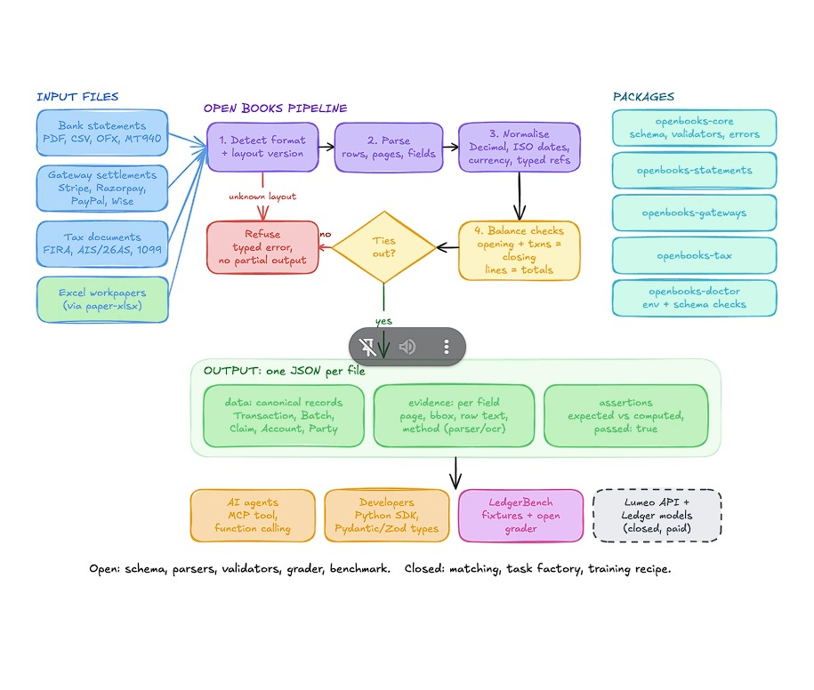
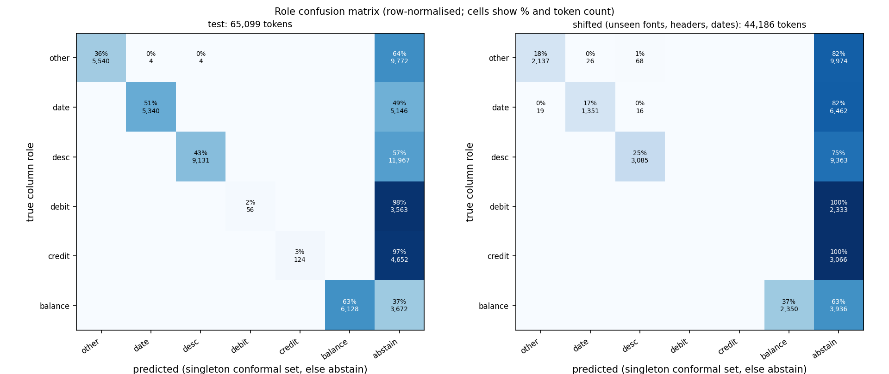

# Open Books

Open Books returns one proven JSON document per financial file, or a typed refusal that names the reason. It reads bank statements, payment-gateway exports, Indian tax documents and Excel workpapers, and releases a result only when the file's own arithmetic balances.

[Developer documentation](https://openbooks.lumeo.co.in/) · [Interactive bank CSV quickstart](https://openbooks.lumeo.co.in/docs/quickstart) · [Workspace](https://openbooks.lumeo.co.in/app) · [MCP server](https://openbooks.lumeo.co.in/docs/mcp)



> **Status: early release.** All training and test data is **synthetic**. No real statements were used or scored, so synthetic results do not prove real-world accuracy. See [Limitations](#limitations).

## Why

Accounting automation fails quietly: a misread digit, a swapped debit and credit, a dropped row. Open Books is built around one rule: **a file is released only when its own arithmetic proves it.**

- `opening + sum(transactions) = closing`, and the running balance ties on every row.
- Settlement `gross - fees - tax = net`, and `sum(net) = payout`.
- At least one assertion must be *independent* evidence (a figure printed in the document), not the parser's own arithmetic.
- Every field carries its evidence: page, bounding box, raw text and extraction method.
- Optional ML heads may add doubt (`LOW_CONFIDENCE`). They can never cause a release. Their calibration is bound to its weights by hash (a mismatch refuses), and every `--model` release names the exact weights that checked it.

## Install

The Python engine requires Python 3.11+. The npm package requires Node.js 20+. Use Node.js 22.12+ and pnpm 10 to develop the web app.

**Just use it** (no checkout): install the npm CLI and its Python engine.

```bash
npm i -g @lumeo_hq/openbooks      # or: npm i @lumeo_hq/openbooks   inside a project
openbooks statement.csv --currency INR --opening 1000.00      # no subcommand needed (same as: openbooks run ...)
```

The npm install hook installs `openbooks[scan]` (Python 3.11+) so PDF and image runs can use the model locally by default. Pass `--no-model` to skip the cross-check. If the install hook is skipped, run `openbooks install-engine --scan`. `openbooks doctor --deep` checks that the model actually loads.

**From a source checkout, one command, everything** (all Python packages, the engine service, the JS workspace and the web app):

```bash
git clone https://github.com/Sagexd08/OpenBooks.git
cd OpenBooks
python scripts/setup.py            # add --scan for OCR + typed heads, --no-js for Python only, --dry-run to preview
```

Just the engine, from PyPI: `pip install openbooks`. Or install from the checkout:

```bash
pip install -e packages/py/openbooks                                       # CSV, OFX, MT940, gateways, tax, XLSX, text-layer PDFs
pip install -e "packages/py/openbooks[scan]"                               # adds OCR for scans and the optional typed heads (EasyOCR, PyTorch, Pillow)
pip install -e packages/py/openbooks-lab                                   # private: training, tests and optional payout matching
```

## Use

```bash
# one openbooks.v1 JSON per input file, written to ./out as <sha256-of-file>.json
# (a refusal is written the same way; exit code is 1 if any file was refused)
openbooks run statement.csv statement.pdf --out out --currency INR

# the file does not state an opening balance
openbooks run statement.pdf --opening 1000.00

# scans: OCR is on by default; refuse them instead with --no-ocr
openbooks run scan.png --no-ocr

# cross-check a PDF or scan with the typed heads (needs models/roles_head.pt)
openbooks run statement.pdf --model

# run every file in a folder, link payouts to bank credits, write report.json
# (same flags as run; a params.json in the folder can give per-file currency/opening/account)
openbooks report ./inbox --out out --currency INR

# link gateway payouts and FIRA remittances to bank credits
openbooks link out/*.json --out links.json

# run the synthetic golden set (balanced documents plus tampered twins that must be refused)
openbooks eval ./golden
```

From Python:

```python
from openbooks.pipeline import process, Params

doc = process("statement.csv", Params(currency="INR"))
if doc["status"] == "ok":
    for t in doc["data"]["transactions"]:
        print(t["date"], t["direction"], t["amount"])
else:
    print(doc["error"]["code"], doc["error"]["message"])
```

## Web app

A batch workspace (Open Books by Lumeo) lives in `web/`, backed by the engine service in `server/`. Attach files or try a synthetic sample, run the checks, and review the released, refused, and interrupted files in the batch. Inspect a released file’s checks and source evidence before downloading its JSON. Retry interrupted files and recoverable refusals from the result card. With a configured OpenRouter model that supports tool calls, you can ask questions about the released documents. Code computes the totals.

```bash
python -m venv .venv
# Activate .venv: .venv\Scripts\Activate.ps1 on PowerShell, or source .venv/bin/activate on macOS/Linux
python -m pip install -e packages/py/openbooks -e "server[scan]"  # local engine, OCR and model
cd web && pnpm install
cp .env.example .env.local                 # optional: OPENBOOKS_LLM_API_KEY and OPENBOOKS_LLM_MODEL for questions
pnpm dev:all                               # engine on 127.0.0.1:8765, web on http://localhost:3000
```

For a single-host deployment, see [Deploy Open Books on one host](deploy/README.md).

For a quick walkthrough, queue **Bank statement CSV** and **Bank CSV without an opening balance** from the sample picker. Run both, then review the checks and download the released JSON. Enter `1000.00` in the refused card to re-run the second file. After a reload, history still shows the results and a retry asks for the original file again.

The service ships with synthetic samples. Install `openbooks-lab` from this checkout to enable payout matching. The model’s per-word reading (role, value type, abstention) is available at `POST /v1/roles`.

The browser only talks to the Next.js server, which proxies to the engine service on loopback. History stays in the browser (IndexedDB); uploaded files are processed in a temp directory and deleted after each run. Tests: `pytest server/tests` and `cd web && pnpm test`. Design: `docs/web/design.md`.

## What you get

```jsonc
{
  "schema_version": "openbooks.v1",
  "status": "ok",
  "file":       { "sha256": "...", "name": "...", "detected_format": "csv", "layout_version": "bank_csv.v1", "method": "parser" },
                // a --model release also records "model": { "weights_sha256": "...", "calibration_sha256": "..." }
  "data":       { "accounts": [...], "batches": [...], "transactions": [...] },   // Transaction, Batch, Claim, Account, Party
  "evidence":   { /* per field: page, bbox, row, raw_text, method */ },
  "assertions": [ { "id": "A1", "rule": "batch-1: opening + sum(txns) = closing",
                    "expected": "...", "computed": "...", "passed": true, "independent": true } ]
}
```

A refusal is `{ "schema_version": "openbooks.v1", "status": "refused", "data": null, "error": { "code", "message", "file_sha256" } }` (no `file` block; the file hash is inside `error`).

| Refusal code | Meaning |
|---|---|
| `UNKNOWN_LAYOUT` | No known layout matches. Never guessed. |
| `UNSUPPORTED_INPUT` | Wrong type, over 20 MB, scan with `--no-ocr`, `--model` without weights, and similar. |
| `PARSE_ERROR` | A layout matched but a field could not be read unambiguously. |
| `BALANCE_MISMATCH` | An assertion failed, or there is no independent balance evidence. |
| `LOW_CONFIDENCE` | The typed heads disagree with, or cannot support, the rule-based reading. |
| `OUTPUT_INVALID` | The result failed its own schema check. |

## Supported inputs

| Input | Layout |
|---|---|
| Bank CSV | `bank_csv.v1` |
| OFX / QFX, MT940 | `ofx.v1`, `mt940.v1` |
| Stripe balance export, Razorpay settlement | `stripe_balance.v1`, `razorpay_settlement.v1` |
| PayPal activity CSV, Wise statement CSV | `paypal_activity.v1` (gross + fee = net per row), `wise_statement.v1` (running balance ties per row) |
| Form 1099-B detail (CSV or XLSX) | `form_1099b.v1` (proceeds - cost + adjustment = gain per row, printed totals) |
| Form 26AS (TDS), AIS, FIRA | `tds_26as.v1`, `ais.v1`, `fira.v1` |
| Trial balance, Excel workpapers | `trial_balance.v1`, `.xlsx` |
| Bank statement PDFs and scans | text layer or OCR, column-geometry row rebuild |

The PayPal, Wise and 1099-B layouts follow public descriptions of those exports and are tested on synthetic fixtures only. Treat them as unverified until real redacted samples exist. The Python packages and npm wrappers are documented in [docs/SERVING.md](docs/SERVING.md). See [docs/ARCHITECTURE.md](docs/ARCHITECTURE.md) for the release rules.

## How it works

1. **Detect** the format and layout version. Unknown layouts are refused.
2. **Parse** rows, pages and fields with a per-layout parser. PDFs and scans rebuild rows from column geometry.
3. **Normalise** to `Decimal` money, ISO dates, currency codes and typed references. Nothing is rounded silently:
   - Amounts accept one consistent digit-grouping system (`1,234,567` or Indian `12,34,567`); ragged or mixed grouping (`12,345,67`, `1,23`) refuses instead of being read as another number. Dr/Cr suffixes and `(brackets)` set the sign.
   - Numeric dates: the day/month order is **proven from the file** (a field above 12 settles it; both orders in one file refuses). With no proof, bank CSVs and bank-statement PDFs default to day-first (Indian layouts), while PayPal and 1099-B refuse rather than guess. `--date-order dmy|mdy` overrides. Many text forms are read (`05-Jan-26`, `5 Sept 2026`, `Jan 5, 2026`, `20260105`, `05.01.2026`). Two-digit years are 20yy, and a year outside 1970 to 2100 refuses.
   - Currency decimals follow ISO 4217 (0 for JPY or VND, 3 for KWD or BHD, else 2); extra decimals refuse, never round.
4. **Balance checks** decide release. Ties out: one JSON. Does not: a typed refusal, no partial output.

For PDFs and scans, an optional ~19M-parameter layout encoder labels each token with a column role and value type. Calibrated conformal prediction sets make it abstain unless it is sure, and constraint-aware resolution keeps only readings that tie the running balance. It is trained from scratch on synthetic data, stored as int8 (about 19 MB), and can only add refusals. Full detail: [docs/ARCHITECTURE.md](docs/ARCHITECTURE.md).

## Measured so far (synthetic data only)

| Check | Result |
|---|---|
| Test suite (`OB_SLOW=1 python -m pytest -q`) | 143 passed at last full run |
| Speed, text-layer PDF (one file, warm) | about 35 ms without `--model`, about 41 ms with it (the model is loaded once per process) |
| Speed, scans | dominated by OCR: about 3 s per page on an RTX 3050 6 GB |
| End-to-end, `--model --scans`, 69 synthetic cases | 100% decisions, 27/27 expected-ok released, 0 false accepts, 0 schema violations |
| File level, PDFs and scans | 15/15 expected-ok released, 0 false accepts (shipped calibration) |
| Typed heads (shipped), synthetic: default test / shifted split | 0 confident-wrong amount tokens on both; shifted coverage 0.988 |
| Typed heads on the sign / branch / skew families they were trained on | coverage about 1.0, 0 confident-wrong |
| Unseen layout families, header parser only, 12 seeds each | branch 12/12 released; sign 4/12 and skew 4/12 with typed refusals; **0 wrong releases** |




Regenerate the figures with `python scripts/plot_model_metrics.py` (needs the cached splits that `scripts/train_roles.py` builds). The confusion matrix has an extra `abstain` column: tokens where the calibrated heads decline to decide. How to read it: there are essentially no off-diagonal errors (0 confident-wrong amount tokens on every split), but the heads commit on only about a third of amount tokens (about a fifth on the shifted split), and on debit and credit they almost always abstain, because the two columns look alike without the balance. The pipeline settles those by keeping only the readings that tie the running balance, so the heads are a safety cross-check, not the source of the numbers.

Evidence files are in [docs/evidence/](docs/evidence/). Reproduce the family numbers with `python scripts/family_baseline.py`.

## Repository layout

```
packages/py/openbooks/        the one public Python package (pip install openbooks):
  src/openbooks/core/         the openbooks.v1 contract, normalisation, gates, layout registry, CLI
  src/openbooks/statements/   bank CSV, OFX, MT940, PDFs; [scan] OCR and the typed heads with their weights
  src/openbooks/gateways/     Stripe, Razorpay, PayPal, Wise
  src/openbooks/tax/          26AS, AIS, FIRA, 1099-B, trial balance (experimental layouts)
  src/openbooks/doctor/       `openbooks doctor`: dependency, provider, model-integrity and self-test checks (human or --json, exit codes 0/1/2/3)
  src/openbooks/pipeline.py   the 0.1 compatibility facade
packages/py/openbooks-lab/    PRIVATE, never published: synthetic data, golden-set builders, calibration fitting, payout matching
server/          FastAPI engine service and deployment tests
web/             Next.js workspace, landing pages and documentation
harness/         agent integration kit and benchmark
scripts/         training, evaluation and release tooling
tests/           pytest suite (set OB_SLOW=1 for the slow tests)
models/          shipped int8 heads (trained on default + sign/branch/skew synthetic layouts), calibration and manifest
docs/            architecture, format catalog, dataset notes, evidence
```

## Documentation

| Read | For |
|---|---|
| [docs/ARCHITECTURE.md](docs/ARCHITECTURE.md) | The product contract, the four stages, refusal codes |
| [docs/MODEL.md](docs/MODEL.md) | How the typed role heads work: inputs, architecture, calibration, training, measured limits |
| [docs/SERVING.md](docs/SERVING.md) | Packages and how they find each other, the engine service and its routes, the web tier, deploy checklist |
| [docs/QA_FLOW.md](docs/QA_FLOW.md) | Question flow end to end, the typed model's place in it, every parameter, request limits, security audit |
| [docs/PROFILE_ROLES.md](docs/PROFILE_ROLES.md) | Measured latency and memory-bandwidth profile of the model (`scripts/profile_roles.py`) |
| [docs/PACKAGES.md](docs/PACKAGES.md) | The package split and publishing plan |
| [docs/format_catalog.md](docs/format_catalog.md), [docs/DATASETS.md](docs/DATASETS.md) | Supported layouts and data sources |

## Develop

See [CONTRIBUTING.md](CONTRIBUTING.md) for setup and verification by component.

```bash
pip install -e "packages/py/openbooks[scan]" -e packages/py/openbooks-lab -e server pytest hypothesis httpx
OB_SLOW=1 python -m pytest -q tests packages/py/openbooks/tests server/tests   # full suite
python tests/characterise/run.py verify              # behaviour frozen before the package split (868 results)
python scripts/family_baseline.py                   # unseen-family baseline
python scripts/train_roles.py 1200 150 12 --out out/roles/candidate-01
python scripts/verify_roles.py out/roles/candidate-01 --scans
```

Training knobs include `--alpha`, `--device`, `OB_SEED`, `OB_LOSS` (`ce`, `ls`, `focalN`), `OB_WIDE`, and `OB_FAMILIES` (`none`, or a comma list of `sign`, `branch`, `skew`). See the [candidate workflow](docs/MODEL.md#6-training-and-shipping).

## Limitations

- Synthetic data only. Real redacted samples (bank statements, 26AS, AIS, FIRA) are the next step and the real test.
- The sign-indicator and skew statement families are currently refused by the header parser (typed refusals, no wrong releases). Training the heads on other families lowers abstention on an unseen one only partly (leave-one-family-out, see `docs/evidence/roles_metrics_fam_*.json`: about 0.67 to 0.83 abstention still), while families the heads have seen are handled well. Real redacted samples are the intended fix.
- Coverage guarantees from conformal calibration assume exchangeable data and weaken on layouts unlike the calibration set.
- Datasets used only for evaluation are never redistributed. Models shipped here are trained on synthetic data alone. See [docs/DATASETS.md](docs/DATASETS.md).

## License

The Python engine, JavaScript package, and designated model artifacts are licensed under Apache-2.0. See [LICENSE.md](LICENSE.md) for the terms governing this checkout and [the release guide](docs/OPEN_SOURCE.md) for the public source export.

## Links

- Developer docs: https://openbooks.lumeo.co.in/docs
- MCP server for AI agents: https://openbooks.lumeo.co.in/docs/mcp (npm package `@lumeo_hq/openbooks`)
- Python package: `openbooks` on PyPI; CLI: `@lumeo_hq/openbooks` on npm
- Source: https://github.com/Sagexd08/OpenBooks
