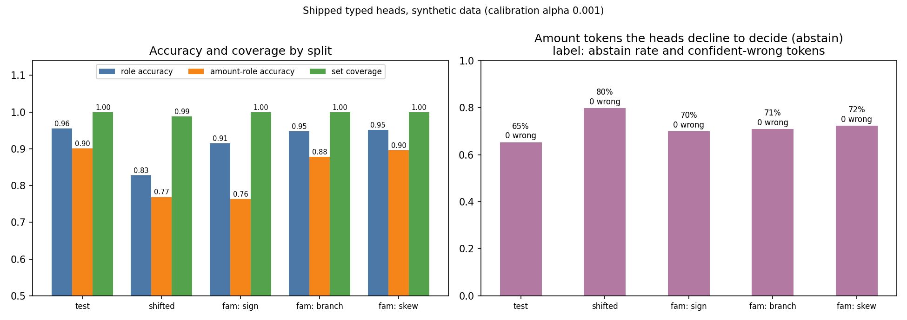

# Open Books

**Turn financial files into one proven JSON document per file, or a typed refusal. Never a partial or guessed result.**

Open Books reads bank statements (CSV, OFX, MT940, PDF, scans), payment-gateway settlements, Indian tax documents and Excel workpapers. It normalises them to a canonical schema and then **proves** the result with balance checks. If the numbers do not tie out, or the layout is unknown, it refuses with a typed error and writes nothing.


> **Status: early (v0.1).** All training and test data is **synthetic**. No real statements were used or scored, so synthetic results do not prove real-world accuracy. See [Limitations](#limitations).

## Why

Accounting automation fails quietly: a misread digit, a swapped debit and credit, a dropped row. Open Books is built around one rule: **a file is released only when its own arithmetic proves it.**

- `opening + sum(transactions) = closing`, and the running balance ties on every row.
- Settlement `gross - fees - tax = net`, and `sum(net) = payout`.
- At least one assertion must be *independent* evidence (a figure printed in the document), not the parser's own arithmetic.
- Every field carries its evidence: page, bounding box, raw text and extraction method.
- Optional ML heads may add doubt (`LOW_CONFIDENCE`). They can never cause a release. Their calibration is bound to its weights by hash (a mismatch refuses), and every `--model` release names the exact weights that checked it.

## Install

Requires Python 3.11 or newer.

```bash
git clone https://github.com/Sagexd08/OpenBooks.git
cd OpenBooks
pip install -e .              # core: CSV, OFX, MT940, gateways, tax, XLSX, text-layer PDFs
pip install -e ".[scan]"      # adds OCR for scans and the optional typed heads (EasyOCR, PyTorch, Pillow)
```

## Use

```bash
# one openbooks.v1 JSON per input file, written to ./out as <sha256-of-file>.json
# (a refusal is written the same way; exit code is 1 if any file was refused)
openbooks run statement.csv statement.pdf --out out --currency INR

# the file does not state an opening balance
openbooks run statement.pdf --opening 1000.00

# scans: OCR is on by default; refuse them instead with --no-ocr
openbooks run scan.png --no-ocr

# cross-check a PDF or scan with the typed heads (needs models/roles_head.pt)
openbooks run statement.pdf --model

# run every file in a folder, link payouts to bank credits, write report.json
# (same flags as run; a params.json in the folder can give per-file currency/opening/account)
openbooks report ./inbox --out out --currency INR

# link gateway payouts and FIRA remittances to bank credits
openbooks link out/*.json --out links.json

# run the synthetic golden set (balanced documents plus tampered twins that must be refused)
openbooks eval ./golden
```

From Python:

```python
from openbooks.pipeline import process, Params

doc = process("statement.csv", Params(currency="INR"))
if doc["status"] == "ok":
    for t in doc["data"]["transactions"]:
        print(t["date"], t["direction"], t["amount"])
else:
    print(doc["error"]["code"], doc["error"]["message"])
```

## Web app

A conversation-style workspace (Open Books by Lumeo) lives in `web/`, backed by a small engine service in `server/`. Drop files into a thread, watch each one go through Detect, Parse, Normalise and Balance, and get one released document or a typed refusal per file, with the checks, per-field evidence and JSON on every card. With a Claude API key you can then ask questions about the released documents. Totals in answers are computed by code, never by the model.

```bash
pip install -e . -e server                 # engine + engine service (FastAPI)
cd web && pnpm install
cp .env.example .env.local                 # optional: ANTHROPIC_API_KEY for questions
pnpm dev:all                               # engine on 127.0.0.1:8765, web on http://localhost:3000
```

The browser only talks to the Next.js server, which proxies to the engine service on loopback. History stays in the browser (IndexedDB); uploaded files are processed in a temp directory and deleted after each run. Tests: `pytest server/tests` and `cd web && pnpm test`. Design: `docs/web/design.md`.

## What you get

```jsonc
{
  "schema_version": "openbooks.v1",
  "status": "ok",
  "file":       { "sha256": "...", "name": "...", "detected_format": "csv", "layout_version": "bank_csv.v1", "method": "parser" },
                // a --model release also records "model": { "weights_sha256": "...", "calibration_sha256": "..." }
  "data":       { "accounts": [...], "batches": [...], "transactions": [...] },   // Transaction, Batch, Claim, Account, Party
  "evidence":   { /* per field: page, bbox, row, raw_text, method */ },
  "assertions": [ { "id": "A1", "rule": "batch-1: opening + sum(txns) = closing",
                    "expected": "...", "computed": "...", "passed": true, "independent": true } ]
}
```

A refusal is `{ "schema_version": "openbooks.v1", "status": "refused", "data": null, "error": { "code", "message", "file_sha256" } }` (no `file` block; the file hash is inside `error`).

| Refusal code | Meaning |
|---|---|
| `UNKNOWN_LAYOUT` | No known layout matches. Never guessed. |
| `UNSUPPORTED_INPUT` | Wrong type, over 20 MB, scan with `--no-ocr`, `--model` without weights, and similar. |
| `PARSE_ERROR` | A layout matched but a field could not be read unambiguously. |
| `BALANCE_MISMATCH` | An assertion failed, or there is no independent balance evidence. |
| `LOW_CONFIDENCE` | The typed heads disagree with, or cannot support, the rule-based reading. |
| `OUTPUT_INVALID` | The result failed its own schema check. |

## Supported inputs

| Input | Layout |
|---|---|
| Bank CSV | `bank_csv.v1` |
| OFX / QFX, MT940 | `ofx.v1`, `mt940.v1` |
| Stripe balance export, Razorpay settlement | `stripe_balance.v1`, `razorpay_settlement.v1` |
| PayPal activity CSV, Wise statement CSV | `paypal_activity.v1` (gross + fee = net per row), `wise_statement.v1` (running balance ties per row) |
| Form 1099-B detail (CSV or XLSX) | `form_1099b.v1` (proceeds - cost + adjustment = gain per row, printed totals) |
| Form 26AS (TDS), AIS, FIRA | `tds_26as.v1`, `ais.v1`, `fira.v1` |
| Trial balance, Excel workpapers | `trial_balance.v1`, `.xlsx` |
| Bank statement PDFs and scans | text layer or OCR, column-geometry row rebuild |

The PayPal, Wise and 1099-B layouts follow public descriptions of those exports and are tested on synthetic fixtures only; treat them as unverified until real redacted samples exist. Other 1099 forms have no arithmetic to prove and are not parsed. Planned, not built: separately installable packages (Python and npm). The step-by-step build, publish and ML-completion guide is [docs/PACKAGES.md](docs/PACKAGES.md). See also [docs/ARCHITECTURE.md](docs/ARCHITECTURE.md).

## How it works

1. **Detect** the format and layout version. Unknown layouts are refused.
2. **Parse** rows, pages and fields with a per-layout parser. PDFs and scans rebuild rows from column geometry.
3. **Normalise** to `Decimal` money, ISO dates, currency codes and typed references. Nothing is rounded silently:
   - Amounts accept one consistent digit-grouping system (`1,234,567` or Indian `12,34,567`); ragged or mixed grouping (`12,345,67`, `1,23`) refuses instead of being read as another number. Dr/Cr suffixes and `(brackets)` set the sign.
   - Numeric dates: the day/month order is **proven from the file** (a field above 12 settles it; both orders in one file refuses). With no proof, bank CSVs and bank-statement PDFs default to day-first (Indian layouts), while PayPal and 1099-B refuse rather than guess. `--date-order dmy|mdy` overrides. Many text forms are read (`05-Jan-26`, `5 Sept 2026`, `Jan 5, 2026`, `20260105`, `05.01.2026`). Two-digit years are 20yy, and a year outside 1970 to 2100 refuses.
   - Currency decimals follow ISO 4217 (0 for JPY or VND, 3 for KWD or BHD, else 2); extra decimals refuse, never round.
4. **Balance checks** decide release. Ties out: one JSON. Does not: a typed refusal, no partial output.

For PDFs and scans, an optional ~19M-parameter layout encoder labels each token with a column role and value type. Calibrated conformal prediction sets make it abstain unless it is sure, and constraint-aware resolution keeps only readings that tie the running balance. It is trained from scratch on synthetic data, stored as int8 (about 19 MB), and can only add refusals. Full detail: [docs/ARCHITECTURE.md](docs/ARCHITECTURE.md).

## Measured so far (synthetic data only)

| Check | Result |
|---|---|
| Test suite (`OB_SLOW=1 python -m pytest -q`) | 143 passed at last full run |
| Speed, text-layer PDF (one file, warm) | about 35 ms without `--model`, about 41 ms with it (the model is loaded once per process) |
| Speed, scans | dominated by OCR: about 3 s per page on an RTX 3050 6 GB |
| End-to-end, `--model --scans`, 69 synthetic cases | 100% decisions, 27/27 expected-ok released, 0 false accepts, 0 schema violations |
| File level, PDFs and scans | 15/15 expected-ok released, 0 false accepts (shipped calibration) |
| Typed heads (shipped), synthetic: default test / shifted split | 0 confident-wrong amount tokens on both; shifted coverage 0.988 |
| Typed heads on the sign / branch / skew families they were trained on | coverage about 1.0, 0 confident-wrong |
| Unseen layout families, header parser only, 12 seeds each | branch 12/12 released; sign 4/12 and skew 4/12 with typed refusals; **0 wrong releases** |




Regenerate the figures with `python scripts/plot_model_metrics.py` (needs the cached splits that `scripts/train_roles.py` builds). The confusion matrix has an extra `abstain` column: tokens where the calibrated heads decline to decide. How to read it: there are essentially no off-diagonal errors (0 confident-wrong amount tokens on every split), but the heads commit on only about a third of amount tokens (about a fifth on the shifted split), and on debit and credit they almost always abstain, because the two columns look alike without the balance. The pipeline settles those by keeping only the readings that tie the running balance, so the heads are a safety cross-check, not the source of the numbers.

Evidence files are in [docs/evidence/](docs/evidence/). Reproduce the family numbers with `python scripts/family_baseline.py`.

## Repository layout

```
src/openbooks/   pipeline, parsers, PDF/scan front end, typed heads, calibration, linking, synthetic generator
scripts/         training, calibration, promotion gate, evaluation, baselines
tests/           pytest suite (set OB_SLOW=1 for the slow tests)
models/          shipped int8 heads (trained on default + sign/branch/skew synthetic layouts), calibration and manifest
docs/            architecture, format catalog, dataset notes, evidence
```

## Develop

```bash
pip install -e ".[scan]" pytest
OB_SLOW=1 python -m pytest -q                       # full suite
python scripts/family_baseline.py                   # unseen-family baseline
python scripts/train_roles.py 1200 150 12           # retrain the heads (GPU recommended)
python scripts/promote.py --baseline docs/evidence/roles_metrics_calibrated.json <candidate.json>   # promotion gate
```

Training knobs: `OB_SEED`, `OB_LOSS` (`ce`, `ls`, `focalN`), `OB_WIDE`, and `OB_FAMILIES` (`none`, or a comma list of `sign`, `branch`, `skew`) for leave-one-family-out runs, which write to `models/fam_<tag>/` and never touch the shipped weights.

## Limitations

- Synthetic data only. Real redacted samples (bank statements, 26AS, AIS, FIRA) are the next step and the real test.
- The sign-indicator and skew statement families are currently refused by the header parser (typed refusals, no wrong releases). Training the heads on other families lowers abstention on an unseen one only partly (leave-one-family-out, see `docs/evidence/roles_metrics_fam_*.json`: about 0.67 to 0.83 abstention still), while families the heads have seen are handled well. Real redacted samples are the intended fix.
- Coverage guarantees from conformal calibration assume exchangeable data and weaken on layouts unlike the calibration set.
- Datasets used only for evaluation are never redistributed. Models shipped here are trained on synthetic data alone. See [docs/DATASETS.md](docs/DATASETS.md).

## License

No license has been chosen yet. Until one is added, all rights are reserved.
