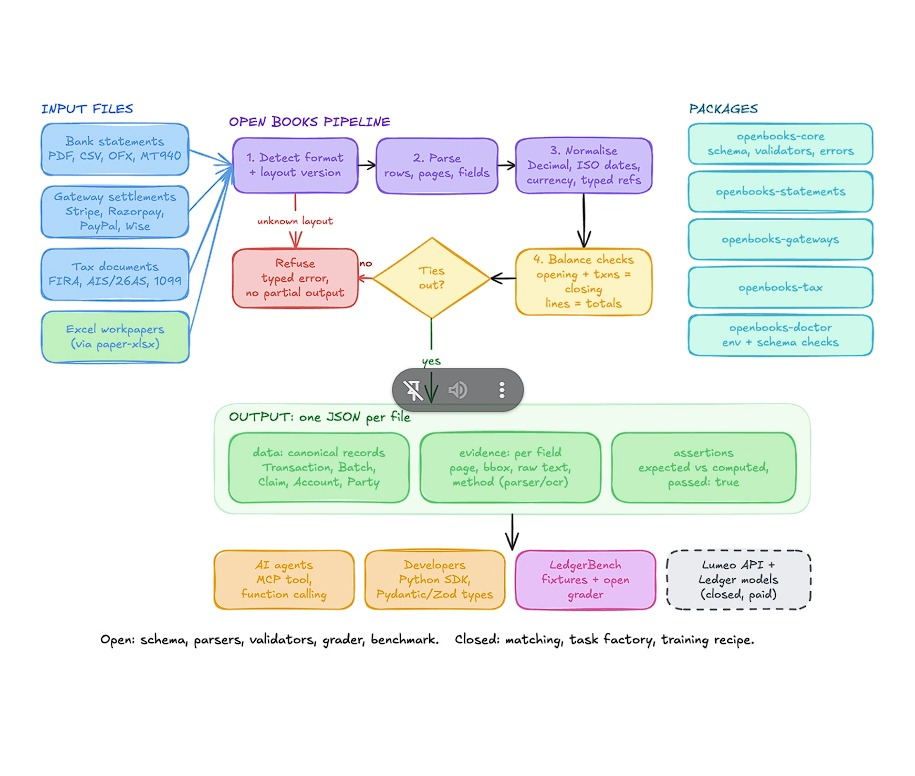
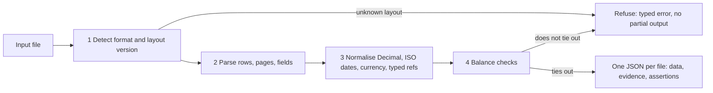
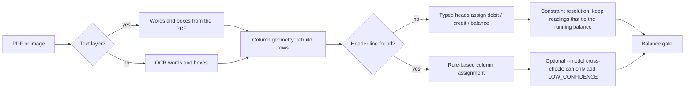

# Open Books: product architecture

Open Books turns financial files into **one proven JSON document per file**, or into a **typed refusal**. It never emits partial output and never guesses a layout.



## 1. Product contract

| Rule | Meaning |
|---|---|
| One file in, one JSON out | Output schema is `openbooks.v1` (`SCHEMA` and `validate_output` in `src/openbooks/pipeline.py`). |
| Proven or refused | A file is released only if every assertion passes and at least one assertion is independent evidence. Otherwise it is refused with a typed code. |
| Money is `Decimal` end to end | Nothing is rounded silently; amounts are formatted with the currency exponent. |
| Evidence for every field | Each field carries page, bbox, raw text and method (`parser`, `pdf_text`, `ocr`, optionally `+model`). |
| Models can only add doubt | The optional typed heads cross-check a PDF/scan parse. They may add `LOW_CONFIDENCE` refusals. They can never cause a release; the balance gate always has the last word. |

### Output document

```
{ schema_version, status: "ok",
  file:       { sha256, name, detected_format, layout_version, method },
  data:       { accounts, batches, transactions, ... }   # Transaction, Batch, Claim, Account, Party
  evidence:   { <record>.<field>: { page, bbox, row, raw_text, method } },
  assertions: [ { id, rule, expected, computed, passed, independent } ] }
```

A refusal is `{ status: "refused", error: { code, message }, file: { sha256 } }`.

### Refusal codes

| Code | When |
|---|---|
| `UNKNOWN_LAYOUT` | No known layout matches the file. Never guessed. |
| `UNSUPPORTED_INPUT` | Wrong type, too large (> 20 MB), scan with `--no-ocr`, `--model` without weights, and similar. |
| `PARSE_ERROR` | The file matched a layout but a field could not be read unambiguously. |
| `BALANCE_MISMATCH` | An assertion failed, or the file offers no independent balance evidence. |
| `LOW_CONFIDENCE` | The typed heads disagree with, or cannot support, the rule-based reading. |
| `OUTPUT_INVALID` | The result failed its own schema check. |

## 2. The four stages



1. **Detect** (`pipeline.detect`, `process`): by extension and content: OFX, MT940, CSV layouts (header search), PDF and images, XLSX. Unknown layouts are refused.
2. **Parse**: one parser per layout (table below). PDFs and scans go through `pdf_front.py`.
3. **Normalise**: `to_dec`, `to_date`, `fmt`, `money`. Indian number grouping, Dr/Cr suffixes, full month names and many date formats are handled here, in one place.
4. **Balance checks** (`run_gate`): the assertions that decide release.

### Supported inputs today

| Input | Layout id / path | Module |
|---|---|---|
| Bank CSV | `bank_csv.v1` | `pipeline.py` |
| OFX / QFX | `ofx.v1` | `pipeline.py` |
| MT940 | `mt940.v1` | `pipeline.py` |
| Stripe balance export | `stripe_balance.v1` | `pipeline.py` |
| Razorpay settlement | `razorpay_settlement.v1` | `pipeline.py` |
| Form 26AS (TDS), AIS, FIRA | `tds_26as.v1`, `ais.v1`, `fira.v1` | `parsers_extra.py` |
| Trial balance | `trial_balance.v1` | `parsers_extra.py` |
| Excel workpapers | `.xlsx` | `parsers_extra.parse_xlsx` |
| Bank statement PDFs (text layer) and scans (OCR) | `pdf_front.extract_document` | `pdf_front.py` |

Not yet built: PayPal, Wise and 1099 parsers, and the split into separately installable packages shown on the diagram (`openbooks-core`, `-statements`, `-gateways`, `-tax`, `-doctor`). Today everything lives in the single `openbooks` package under `src/`.

### Balance checks (stage 4)

For every statement batch: `opening + sum(transactions) = closing`; running balance ties on every row; no-movement rows leave the balance unchanged; the document's stated closing equals the last running balance; and each period's closing equals the next period's opening. For settlements: `gross - fees - tax = net` on every row and in total, and `sum(net) = payout`. Tax documents add their own totals through `extra_gate`. An assertion marked `independent` is evidence that does not come from the parser's own arithmetic (for example a figure printed in the document). Derived opening balances (`--allow-derived-opening`) are never counted as independent.

## 3. PDF and scan front end



Rows are rebuilt from column geometry and handed to the same statement builder and balance gate as CSV, so a misread number becomes a `BALANCE_MISMATCH`, not a wrong release.

### Typed heads (optional, `--model`)

- `encoder.py`: a LayoutLM-style encoder (hashed word and shape embeddings plus 2D box embeddings), about 19M parameters, trained **from scratch on synthetic data only**, stored as int8 (about 19 MB).
- `roles.py`: two heads per token: column role and value type, with abstention.
- `calibration.py`: temperature scaling plus split-conformal prediction sets. A token is trusted only when its set holds exactly one class; otherwise it abstains.
- `Predictions.resolve`: inside an abstaining set, enumerate readings and keep those that tie the previous running balance; resolve only if exactly one survives.
- Coverage guarantees need exchangeable data. On layouts unlike the calibration set they can weaken, so the abstain rate and coverage are measured on held-out layouts (`docs/evidence/`).

## 4. Linking (`link.py`, `openbooks.links.v1`)

Links gateway payouts and FIRA remittances to the bank credits that received them. Amounts must be exactly equal (Decimal) with the same currency and a bank date inside a window after the source date. Date closeness and reference matches only rank candidates. The best assignment is a maximum-weight bipartite matching. If a second assignment ties, the link is reported as ambiguous and not made. Several sources may share one credit only when their exact sum equals it and exactly one such subset exists.

## 5. Synthetic data and evaluation

All training and test data is synthetic. No real statements are used or scored.

- `synth.py` renders random bank-statement layouts to PDF (text layer) and to scans, and labels every word by the cell it came from.
- Splits use disjoint layout seeds: train, calibration, test, and a **shifted** test (font sizes, header words and date formats never seen in training).
- Layout **families** (`random_layout(..., family="sign" | "branch" | "skew")`) model whole unseen statement styles: a +/- indicator column, dot-matrix branch print with truncated narration, and transaction/value-date skew. Families are held out for leave-one-family-out evaluation. Details: `docs/format_catalog.md`.
- `golden.py` and `golden_docs.py` build a golden set: balanced documents plus tampered twins that must be refused (`python -m openbooks.pipeline eval <root>`).
- Evidence for measured claims lives in `docs/evidence/*.json`.

## 6. Repository map

```
src/openbooks/
  pipeline.py        detect, parse (CSV/OFX/MT940/gateways), normalise, balance gate, schema, CLI
  parsers_extra.py   26AS, AIS, FIRA, trial balance, XLSX
  pdf_front.py       PDF and scan front end (text layer, OCR, column geometry)
  roles.py           typed heads at inference time, constraint-aware resolution
  encoder.py         layout encoder and int8 quantisation
  calibration.py     temperature scaling, conformal sets, ECE
  link.py            payout / remittance to bank-credit linking
  synth.py           synthetic statement renderer, layout families, scan noise
  golden.py, golden_docs.py   golden sets and tampered twins
  bitenc.py          experimental byte-level word embedding
scripts/             training, calibration, promotion gate, evaluation, baselines
tests/               pytest suite (OB_SLOW=1 enables the slow tests)
models/              shipped int8 heads, calibration, manifest
docs/                architecture, format catalog, datasets, handoff, evidence
```

## 7. Roadmap (not yet implemented)

- PayPal, Wise and 1099 parsers; separate installable packages.
- Parser rules or head coverage for the sign-indicator and skew families (currently typed refusals, never wrong releases).
- Real, redacted samples from pilot users; synthetic-only results do not prove real-world accuracy.
- Export of the heads to ONNX int8 for NPU inference.
