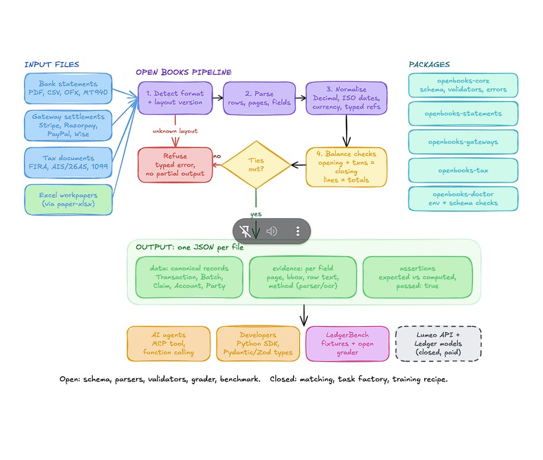

# Building and publishing the Open Books packages

> **Superseded for Python (0.2.0).** The five Python distributions planned here (`openbooks-core`, `-statements`, `-gateways`,
> `-tax`, `-doctor`) and the meta package were published as 0.1.0 and then merged into one package, `openbooks`, with the same
> code as `openbooks.core`, `openbooks.statements`, `openbooks.gateways`, `openbooks.tax` and `openbooks.doctor`. For installing,
> upgrading from 0.1 and releasing, see [PYTHONOPENBOOKSPACKAGES.md](PYTHONOPENBOOKSPACKAGES.md). The npm sections still apply.
> The rest of this page is kept as the original plan.

> The split described here exists on `main` (`packages/py/*`, `packages/js/*`). For how the packages are wired at runtime and served, see [SERVING.md](SERVING.md); for the model, see [MODEL.md](MODEL.md). This page remains the plan and the publishing checklist.

> **Status (branch `feat/openbooks-core-package`, unreleased, nothing published):** all five Python packages exist
> (`openbooks-core`, `-gateways`, `-tax`, `-statements`, `-doctor`) plus the `openbooks` meta package, and the npm workspace
> `packages/js` (`@lumeo_hq/openbooks-core|statements|gateways|tax|doctor` and the `openbooks` CLI) wraps the Python engine. Closed code
> (training, synthetic data, golden builders, matching) lives in the private `packages/py/openbooks-lab` and is never published.
> `docs/research/OPENBOOKS_PACKAGING_RESEARCH.md` has the audit, decisions and plan, and supersedes parts of this document
> (matching is not shipped in gateways; core owns the `openbooks` console script; PDF and OCR are extras; types come from the JSON
> Schema with Ajv validation instead of a hand-written Zod layer). Still open: licence, PyMuPDF (AGPL) strategy, the public/private
> repo split, name reservation, real-sample evaluation, and the first TestPyPI / npm dry run.

Audience: a teammate with write access who will pull this repo, split it into the five packages on the pipeline diagram, publish them (PyPI and npm), and finish the ML side of the workflow. Nothing here has been built or published yet. Everything marked **verified** was run against this repo on 2026-11-18.



## 0. TL;DR plan (do in this order)

1. Resolve the open decisions in section 9 (they gate a public release).
2. Python: split `src/openbooks` into `openbooks-core`, `-statements`, `-gateways`, `-tax`, `-doctor` behind a layout registry (section 3). Keep `pip install openbooks` as a meta package so nothing breaks.
3. npm: add the `openbooks` CLI with subcommands plus `@lumeo_hq/openbooks-*` packages that wrap the Python engine and ship typed, validated output (section 4).
4. ML: close the end-to-end gaps (section 6).
5. Publish to TestPyPI and an npm dry run first, then real (section 7).

## 1. What exists today

One Python package, `openbooks` (`src/openbooks/`), 143 tests, and a working CLI: `openbooks run | report | link | eval`. The pipeline is `detect -> parse -> normalise -> balance checks`; a file is released as one JSON or refused with a typed code (see [ARCHITECTURE.md](ARCHITECTURE.md)). Optional ML heads (`--model`) can only add refusals.

Map from today's modules to the diagram's packages:

| Diagram package | Contents (today's files) |
|---|---|
| `openbooks-core` | `pipeline.py` shared parts: `Refusal`, `Params`, `SCHEMA`, `validate_output`, `to_dec`, `to_date`, `date_order`, `fmt`, `money`, `evidence`, `guard`, `decode`, `statement_doc`, `run_gate`, `process`, CLI `main`; `parse_xlsx` front end |
| `openbooks-statements` | bank CSV, OFX, MT940 parsers; `pdf_front.py`; the ML heads: `roles.py`, `encoder.py`, `calibration.py`, `bitenc.py`; `models/` (weights, calibration, manifest) |
| `openbooks-gateways` | `parse_stripe`, `parse_razorpay`, `parse_paypal`, `parse_wise` (`parsers_more.py`); `link.py` (payout to bank-credit linking) |
| `openbooks-tax` | `parse_tds` (26AS), `parse_ais`, `parse_fira`, `parse_trial_balance` (`parsers_extra.py`); `parse_1099b` (`parsers_more.py`); their `extra_gate` branches |
| `openbooks-doctor` | **does not exist yet**: environment and schema checks (section 3.5) |
| not shipped | `synth.py`, `golden.py`, `golden_docs.py`, `scripts/` (training recipe, evaluation): dev tooling. The diagram lists the training recipe as closed; see section 9. |

## 2. Target architecture

The Python engine stays the single source of truth for parsing and proving. Re-implementing parsers in TypeScript would fork the accuracy story, so npm packages are **typed wrappers** over the engine:

```
npm: @lumeo_hq/openbooks (CLI) -> @lumeo_hq/openbooks-{core,statements,gateways,tax,doctor}
          |  spawns:  python -m openbooks.pipeline run ...   (JSON in <out>/<sha256>.json)
          v
PyPI: openbooks (meta) -> openbooks-{core,statements,gateways,tax,doctor}
```

Dependency direction: `statements`, `gateways`, `tax` depend on `core`; `doctor` depends on `core` and inspects whichever others are installed. Extras: `openbooks-statements[scan]` adds OCR and PyTorch (EasyOCR, torch, pillow).

Names (**verified** 2026-11-18, HTTP 404 = not found): npm `openbooks`, `openbooks-core`, `openbooks-doctor`, `@lumeo_hq/openbooks-core`; PyPI `openbooks`, `openbooks-core`. A 404 on `@lumeo_hq/openbooks-core` does not prove the npm scope is free; the packages are published under the `@lumeo_hq` org (owned by the publishing account).

## 3. Part A: Python packages

### 3.1 Layout

```
packages/py/
  openbooks-core/        pyproject.toml  src/openbooks_core/...
  openbooks-statements/  pyproject.toml  src/openbooks_statements/...   (+ models/ as package data)
  openbooks-gateways/    pyproject.toml  src/openbooks_gateways/...
  openbooks-tax/         pyproject.toml  src/openbooks_tax/...
  openbooks-doctor/      pyproject.toml  src/openbooks_doctor/...
  openbooks/             pyproject.toml  (meta: depends on all five; re-exports `openbooks.pipeline`)
```

Use import packages with distinct names (`openbooks_core`, ...) so the pieces install independently, and keep `import openbooks.pipeline` working through the meta package (a thin shim that re-exports `process`, `Params`, `Refusal`, `main`). The existing tests import `openbooks.*`; keep them green against the meta package.

### 3.2 The real work: a layout registry

Today `find_header` (detection), `run_layout` (parser table) and `run_gate`/`extra_gate` (checks) hard-code every layout inside `pipeline.py`. Splitting packages means making them pluggable. Use entry points:

```python
# openbooks_core/registry.py
@dataclass(frozen=True)
class Layout:
    id: str                       # "paypal_activity.v1"
    priority: int                 # detection order (lower runs first); keep today's order
    matches: Callable[[set[str]], bool]          # normalised header set -> bool
    parse: Callable[[tuple, Params], tuple[dict, dict]]   # (rows, header_index, headers), params -> (data, evidence)
    gate: Callable[[dict], Iterable[tuple[str, str, str, bool]]] | None = None   # extra assertions

def layouts() -> list[Layout]:
    return sorted((ep.load()() for ep in entry_points(group="openbooks.layouts")), key=lambda l: l.priority)
```

Each package registers its layouts in its `pyproject.toml`:

```toml
[project.entry-points."openbooks.layouts"]
paypal = "openbooks_gateways.layouts:paypal"
wise   = "openbooks_gateways.layouts:wise"
```

Rules to preserve (they are covered by tests; do not loosen them):
- Detection order is today's order: stripe, razorpay, paypal, wise, 1099-B, 26AS, AIS, FIRA, bank CSV, trial balance. Put those numbers in `priority`.
- An unknown layout still raises `Refusal("UNKNOWN_LAYOUT")`. A missing optional package must never turn into a guess: if a file looks like a layout whose package is not installed, `doctor` and the error text say which package to install.
- `run_gate` keeps the statement and settlement checks in core; per-kind extra checks come from the layout's `gate`.
- Circular imports today: `pipeline` imports `parsers_extra` lazily and `parsers_extra` imports `pipeline`. Moving the shared helpers (`_body`, `_currency`, `_empty_data`, `evidence`, `money`, `to_dec`, `to_date`, `statement_doc`, `_settlement`, `Refusal`, `Params`) into `openbooks_core` removes the cycle.

### 3.3 Steps

1. Create `packages/py/openbooks-core` and move the shared helpers, `SCHEMA`, `validate_output`, `process`, `guard`/`decode`, the CLI and `parse_xlsx`. Add `registry.py` and make `detect`/`run_gate` use it.
2. Move parsers into `-statements`, `-gateways`, `-tax`; register each layout.
3. Move `pdf_front.py`, `roles.py`, `encoder.py`, `calibration.py`, `bitenc.py` and `models/` into `-statements`. `roles.py` loads `models/roles_head.pt` relative to its own location today (`ROOT / "models"`): change it to `importlib.resources` so it finds package data after install. Keep the weights/calibration hash binding intact (`RoleModel.load` refuses a mismatch).
4. Ship `models/roles_head.pt` (about 19 MB, under PyPI's size limit) and `roles_calibration.json` as package data in the same wheel so the hash binding can never see a mismatched pair. Do not ship `models/jepa_encoder.pt` (pretrained on CORD, internal only; it is gitignored).
5. Split `tests/` per package; keep one cross-package suite that installs the meta package and runs everything (`OB_SLOW=1 python -m pytest -q`, 143 tests today).
6. Build each: `python -m build` in each package directory. Check the wheel contents (`unzip -l`), especially that the weights and calibration are present and `synth.py` is not.
7. Install the five wheels into a fresh venv and run section 8's acceptance checks.

### 3.4 `openbooks` meta package

Depends on the five packages, re-exports `openbooks.pipeline`, and keeps the `openbooks` console script (`openbooks = "openbooks_core.cli:main"`).

### 3.5 `openbooks-doctor` (new, small)

An `openbooks doctor` subcommand. It should check and print pass/fail with a fix hint for each:
- Python >= 3.11; core dependencies import (`jsonschema`, `openpyxl`, `pymupdf`, `numpy`, `scipy`).
- Installed layouts: list from the registry; flag any family of layouts whose package is missing.
- Scan extra: `torch`, `easyocr`, `pillow` present; GPU available or not (informational).
- Model integrity: `roles_head.pt` and calibration load, `weights_sha256` matches, manifest present, parameter count within budget.
- Schema: the packaged `openbooks.v1` JSON Schema validates a built-in golden sample; run the golden set (`openbooks eval`) and require 0 false accepts.
- Exit code non-zero on any failure, `--json` for machine output.

## 4. Part B: the npm packages and subcommands

### 4.1 Layout (npm workspaces)

```
packages/js/
  package.json              { "private": true, "workspaces": ["*"] }
  core/         @lumeo_hq/openbooks-core         types + Zod schema + runEngine()
  statements/   @lumeo_hq/openbooks-statements   openbooks statements ...
  gateways/     @lumeo_hq/openbooks-gateways     openbooks gateways ...
  tax/          @lumeo_hq/openbooks-tax          openbooks tax ...
  doctor/       @lumeo_hq/openbooks-doctor       openbooks doctor
  cli/          openbooks               the umbrella binary with all subcommands
```

### 4.2 Generate the types from the real schema

The output schema lives in `SCHEMA` in `pipeline.py` and exports as plain JSON (**verified**). Export it, then generate Zod and TypeScript from it so the contract cannot drift:

```bash
python -c "import json,sys; sys.path.insert(0,'src'); from openbooks.pipeline import SCHEMA; print(json.dumps(SCHEMA, indent=2))" > packages/js/core/schema/openbooks.v1.schema.json
npx json-schema-to-zod -i packages/js/core/schema/openbooks.v1.schema.json -o packages/js/core/src/schema.ts
```

Add that export as a script in `package.json` and a CI check that fails if the committed file differs from a fresh export. A refusal document is `{ "schema_version": "openbooks.v1", "status": "refused", "data": null, "error": {"code","message","file_sha256"} }` (no `file` block; see `refusal_doc` in `pipeline.py`): add its Zod type by hand in `core` and export `OpenBooksResult = z.union([Ok, Refused])`.

### 4.3 `@lumeo_hq/openbooks-core`

```ts
// src/engine.ts
import { execFile } from "node:child_process";
import { promisify } from "node:util";
import { mkdtemp, readdir, readFile } from "node:fs/promises";
import { tmpdir } from "node:os";
import { join } from "node:path";
import { OpenBooksResult } from "./schema";

const run = promisify(execFile);

export interface RunOptions { currency?: string; opening?: string; account?: string; allowDerivedOpening?: boolean;
  dateOrder?: "dmy" | "mdy"; model?: boolean; ocr?: boolean; python?: string }

export async function runFile(file: string, o: RunOptions = {}) {
  const out = await mkdtemp(join(tmpdir(), "ob-"));
  const args = ["-m", "openbooks.pipeline", "run", file, "--out", out];
  if (o.currency) args.push("--currency", o.currency);
  if (o.opening) args.push("--opening", o.opening);
  if (o.account) args.push("--account", o.account);
  if (o.allowDerivedOpening) args.push("--allow-derived-opening");
  if (o.dateOrder) args.push("--date-order", o.dateOrder);
  if (o.model) args.push("--model");
  if (o.ocr === false) args.push("--no-ocr");
  let stderr = "";
  try { await run(o.python ?? "python", args); } catch (e: any) { stderr = String(e.stderr ?? e.message); }
  const [name] = await readdir(out);
  // A refusal exits 1 but still writes <sha256>.json; a missing engine also exits 1 but writes nothing (all three verified).
  if (!name) throw new Error(`openbooks engine did not run (is it installed? try: openbooks doctor)\n${stderr}`);
  return OpenBooksResult.parse(JSON.parse(await readFile(join(out, name), "utf8")));
}
```

Notes: `openbooks run` writes `<sha256>.json` to `--out`. Exit code 0 = released, 1 = refused **or** the engine could not start, so decide by whether the output file exists, never by the exit code alone (**verified**: refused gives rc 1 with a file, released rc 0 with a file, missing engine rc 1 with no file). Parse with Zod so a schema drift fails loudly. Also export `runReport(folder, opts)` (wraps `report`) and `link(files)` (wraps `link`).

### 4.4 Subcommands

Use `commander` in `cli/`. Each blue-box package contributes a subcommand and the umbrella registers them:

| Command | Does |
|---|---|
| `openbooks run <files...>` | auto-detect any supported file (the Python `run`) |
| `openbooks statements run <files...>` | same, restricted to statement layouts (bank CSV, OFX, MT940, PDF, scans) |
| `openbooks gateways run <files...>` | Stripe, Razorpay, PayPal, Wise |
| `openbooks tax run <files...>` | 26AS, AIS, FIRA, 1099-B, trial balance |
| `openbooks report <folder>` | run a folder, link payouts to bank credits, write `report.json` |
| `openbooks link <files...>` | payout/remittance to bank-credit linking |
| `openbooks doctor` | section 3.5 checks (shells to `python -m openbooks_doctor`) |
| `openbooks model info\|predict\|eval` | section 5 |

Shared flags map one-to-one to the Python CLI: `--currency --opening --account --allow-derived-opening --date-order dmy|mdy --no-ocr --model --out`. The restricted subcommands simply check the detected layout id against their package's list and print a typed refusal (`UNKNOWN_LAYOUT`) otherwise; do not re-implement detection in JS.

```json
// packages/js/cli/package.json
{ "name": "openbooks", "version": "0.1.0", "type": "module", "bin": { "openbooks": "dist/cli.js" },
  "files": ["dist"], "engines": { "node": ">=20" },
  "dependencies": { "@lumeo_hq/openbooks-core": "0.1.0", "@lumeo_hq/openbooks-statements": "0.1.0", "@lumeo_hq/openbooks-gateways": "0.1.0",
                    "@lumeo_hq/openbooks-tax": "0.1.0", "@lumeo_hq/openbooks-doctor": "0.1.0", "commander": "^12.0.0" } }
```

`dist/cli.js` starts with `#!/usr/bin/env node`. Build with `tsc`; test with `vitest` by running the real engine on the golden files (`python -m openbooks.pipeline eval` builds them) and asserting that tampered files come back `refused` with the right code.

The npm package needs the Python engine on the machine. `openbooks doctor` must detect a missing or too-old engine and print `pip install openbooks`. Do not bundle Python in the npm tarball.

## 5. Calling the model and showing results

**Python API (verified against the shipped weights):**

```python
from pathlib import Path
from openbooks.pipeline import Params
from openbooks.pdf_front import read_words
from openbooks.roles import RoleModel

model = RoleModel.load()                      # cached per process; raises Refusal if calibration does not match the weights
print(model.identity)                         # {'weights_sha256': ..., 'calibration_sha256': ...}
pages, method = read_words(Path("statement.pdf"), Params(ocr=True))   # words with boxes, from the text layer or OCR
preds = model.predict(pages)
pred = preds.get(pages[0][0])                 # Pred(role='other', role_set=('other',), vtype='money', type_set=('money',)) or None
# pred.role_set has exactly one role when the heads are sure; more than one means "abstain".
```

**CLI and output:** `openbooks run statement.pdf --model` cross-checks with the heads; a released document records `file.model = { weights_sha256, calibration_sha256 }`, so every result is traceable to the weights that checked it. Without PyTorch the command refuses with an install hint.

**Showing metrics:** `python scripts/plot_model_metrics.py` regenerates `docs/figures/model_accuracy.png` and `confusion_role.png` and `docs/evidence/model_confusion.json` (needs the cached splits from `scripts/train_roles.py`). Proposed `openbooks model` subcommands (to build):
- `model info`: load the manifest and calibration; print parameter count, alpha, weights hash, families trained on, metrics file.
- `model predict <file>`: print the per-token role, role set and abstain flag as JSON or a table.
- `model eval`: run the splits and write the figures; fail if the promotion gate (`scripts/promote.py`) would reject.

Honest reading of today's numbers: the heads make 0 confident-wrong amount calls on every synthetic split but commit on only about 35% of amount tokens (about 20% on the shifted split), and abstain on debit/credit almost always. The balance-chain resolution does the real disambiguation. The heads are a safety cross-check.

## 6. ML work to make the workflow end to end

Status today: data generation, training, calibration, evaluation, a promotion gate and serving exist as separate scripts run by hand. These steps connect and harden them. Each has an acceptance check.

| # | Task | Acceptance |
|---|---|---|
| M1 | `scripts/ml_pipeline.py` driver: generate data, validate, train, calibrate (shift-aware, alpha 0.001, `scripts/score_family_candidate.py`), evaluate, gate (`scripts/promote.py`), promote, regenerate manifest. One command, idempotent, stage caching keyed by input hashes. | `python scripts/ml_pipeline.py` reproduces the shipped metrics within noise from a clean checkout |
| M2 | `scripts/promote_model.py`: copy weights, bind `weights_sha256` into the calibration, regenerate `models/roles_manifest.json` (source hashes, families, metrics file) and the baseline evidence. Today this was done by hand. | a promotion is one command and `tests/test_integrity.py` passes |
| M3 | Data validation at generation time: label-balance report, no split overlap (seeds are disjoint by construction: assert it), every word labelled, no overprint; fail the run, not just a test. | a deliberately broken generator change fails the driver |
| M4 | Data versioning: hash the dataset pickles and `synth.py` and record both in the manifest; today a cached pickle is reused even after `synth.py` changes (cache is keyed only by `n_tr`, `n_oc`). DVC or a plain hash manifest is fine. | changing `synth.py` invalidates the cache |
| M5 | Experiment tracking: log every run (config, seed, data hash, metrics) to MLflow's local file store or a JSONL file, so runs have IDs instead of loose `docs/evidence/*.json`. | every evidence file names its run ID |
| M6 | CI (`.github/workflows/ci.yml`): `pytest -q`, `scripts/family_baseline.py`, `scripts/file_level.py`, the integrity tests, and `promote.py` against the committed baseline on any change under `models/`. Add the schema-drift check from section 4.2. | a PR that weakens the gate goes red |
| M7 | Real samples: collect redacted statements (bank PDFs, 26AS, AIS, FIRA, PayPal, Wise, 1099-B exports). Evaluate and re-calibrate on them. This is the real test; all numbers so far are synthetic, and the PayPal, Wise and 1099-B layouts are unverified. | a real-sample split in `docs/evidence/` with abstention and confident-wrong reported |
| M8 | Reduce abstention on unseen layouts (67 to 83% today): more family variety in `synth.py`, calibrate on real data (M7), try byte-level embeddings (`bitenc.py`, `train_roles_bits.py` exist), try ConfTS/SAPS-style set-size-minimising calibration. Keep the gate: 0 confident-wrong. | lower held-out abstention with the gate still green |
| M9 | Monitoring: aggregate `report.json` over time (release rate, refusal codes, abstain rate, model hash per release); alert on drift in refusal mix or abstain rate; log the model hash (already in `file.model`). | a dashboard or weekly script output from real runs |
| M10 | Inference export (optional): ONNX int8 export and a parity test against the torch int8 path; NPU only after that. | parity test passes within tolerance |
| M11 | Serving (the "live" workflow): a small FastAPI service with `POST /process` (file in, `openbooks.v1` or typed refusal out), `GET /model` (identity and metrics), `GET /healthz` (runs doctor). Same engine, no new logic. Started: `server/` (FastAPI, used by the `web/` app) already serves `POST /v1/runs` (per-file stage events over SSE), `POST /v1/link`, `GET /v1/health` and `GET /v1/formats`; extend it rather than starting a second service. | the section 8 e2e checks pass over HTTP |
| M12 | Early stopping on a dedicated validation split (calibration data must stay separate to avoid leakage). | no change in held-out metrics, shorter runs |

Known limits to keep visible: numeric dates are day-first unless proven otherwise (`--date-order`); other 1099 forms have no arithmetic to prove and are not parsed; scans cost about 3 s per page (OCR).

## 7. Publishing checklist

PyPI (use TestPyPI first):
1. Create the PyPI project names (`openbooks`, `openbooks-core`, `-statements`, `-gateways`, `-tax`, `-doctor`); enable trusted publishing from GitHub Actions; no long-lived tokens in the repo.
2. `python -m build` per package; `twine check dist/*`; install from TestPyPI into a fresh venv and run section 8.
3. Publish in dependency order: core, then statements/gateways/tax, then doctor, then the meta package. Pin `openbooks-core>=X,<Y` in the others.

npm:
1. Use the `@lumeo_hq` org; enable 2FA on the publishing account.
2. `npm pack` in each package and inspect the tarball (only `dist`, `schema`, README, licence).
3. `npm publish --dry-run`, then publish from CI with `--access public --provenance`. Publish `@lumeo_hq/openbooks-core` first, `openbooks` last. Note that npm unpublish is time-limited: treat every publish as permanent.

Both: one version number for all packages (changesets or a script), a CHANGELOG, and a licence file (none is chosen yet; see section 9).

## 8. Acceptance: when is it done?

In a fresh venv and a fresh Node install, with only published or locally packed artifacts:
1. `pip install openbooks` then `openbooks doctor` is green (exit 0).
2. `openbooks eval <golden-root>` gives `mismatches=0 false_accepts=0` (build the golden set with `openbooks.golden.build`).
3. `openbooks run statement.csv --currency INR --opening 1000.00 --out out` writes a document that validates against the packaged schema; a tampered copy is refused `BALANCE_MISMATCH`.
4. `npm i -g @lumeo_hq/openbooks` then `openbooks statements run statement.csv ...` returns the same JSON, Zod-validated; `openbooks gateways run` on a PayPal sample and `openbooks tax run` on a 1099-B sample release; a wrong-package file returns `UNKNOWN_LAYOUT`.
5. `openbooks run statement.pdf --model` (with `[scan]`) records `file.model` and refuses cleanly when torch is missing.
6. The full suite passes against the meta package: `OB_SLOW=1 python -m pytest -q` (143 tests today), including the mutation test: no single-cell change to a valid statement is ever released.

## 9. Decisions still open (needed before a public release)

1. **Open vs closed.** The diagram says open: schema, parsers, validators, grader, benchmark; closed: matching, task factory, training recipe. The repo currently has `link.py` (matching) and `scripts/train_roles.py` (training recipe) public. Decide what ships on PyPI/npm and what moves to a private repo before publishing anything. Publishing is effectively permanent.
2. **Licence.** None chosen; until then all rights are reserved.
3. **Names and scope.** Confirm the `@lumeo_hq` npm org and the PyPI names (section 2).
4. **LedgerBench, the Lumeo API and the Ledger models** on the diagram are not in this repo and are out of scope here.
5. **Unverified layouts.** PayPal, Wise and 1099-B parsers follow public descriptions and synthetic fixtures. Mark them experimental in the package README until M7.
