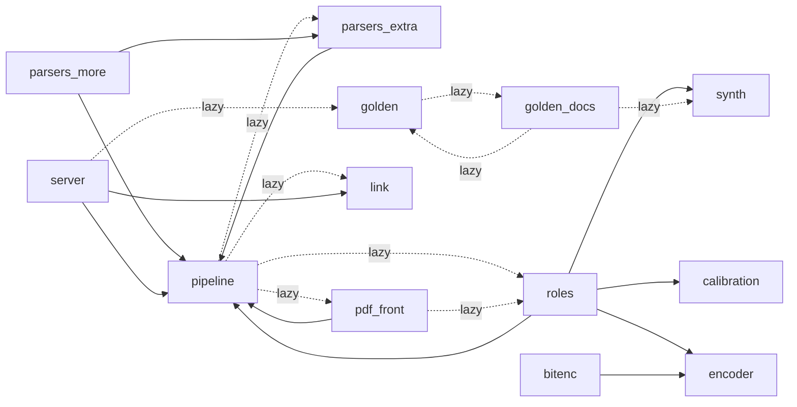
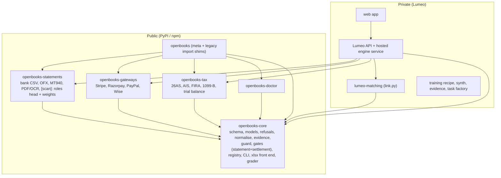
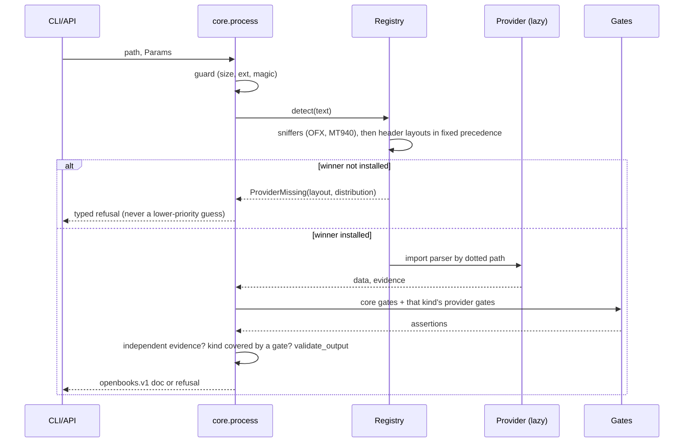
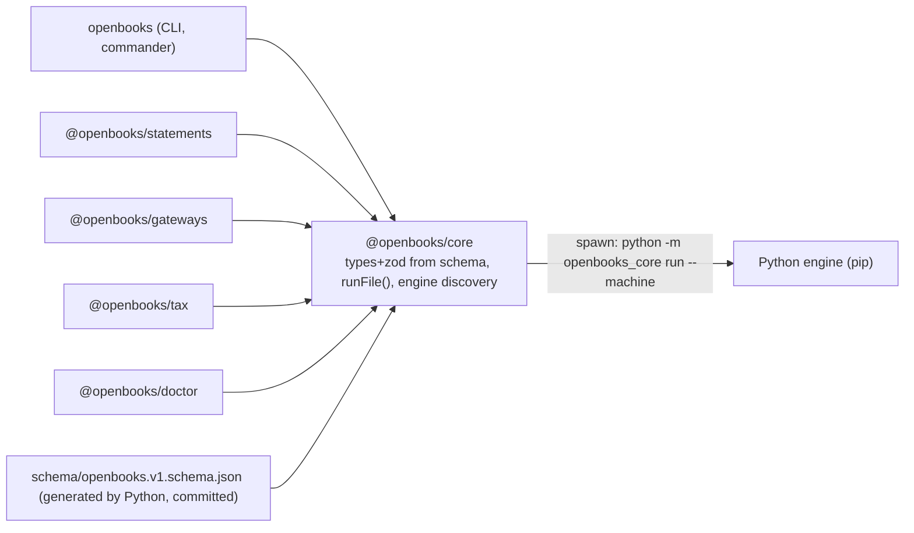

# Open Books: modularisation research and implementation plan

Status: **research only. No source, config or branch was changed to produce this.** This file is the only thing added (untracked, under `docs/research/`). Date: 2026-11-18. Repo state inspected: `main` at `b197f49`; remote branch `origin/feat/openbooks-core-package` (3 scaffold commits) read but not checked out.

Legend: **[V]** verified in this session by reading code or running something. **[R]** recommendation. **[U]** uncertain or not verified. External links are listed in section 15; those marked (searched) were returned by a web search this session, the rest are standard official pages I did not re-fetch, so re-check version numbers before acting on them.

---

## 0. Executive summary

1. The split is feasible, and the registry is a small amount of code. The real risks are **not** import mechanics. They are: (a) the gate and detection logic has hidden cross-family coupling; (b) a missing optional provider could let a *looser* parser (bank CSV, trial balance) claim a file meant for the missing one; (c) `process()` converts every unexpected exception, including a missing dependency, into a `PARSE_ERROR` refusal, which makes "refusal vs crash" indistinguishable to wrappers; (d) the shipped model path only works from a source checkout.
2. `SCHEMA` is too thin to be the source of truth for TypeScript types. It validates the envelope, but `data.accounts/batches/transactions` records have no per-record schema [V]. Generating Zod from it gives `any[]`. A real `openbooks.v1` JSON Schema must be written first (additive, tested against every golden output).
3. PACKAGES.md puts `link.py` (matching) in the public gateways package. The product diagram says matching is closed. These conflict; this needs your decision before anything is published. The repo is currently **PRIVATE** with **no licence** [V: `gh repo view`].
4. `roles.py` imports `synth.py` (a training-data generator that imports PyMuPDF at module top) just to get the `ROLES` list [V]. The model path cannot be packaged cleanly until that constant moves.
5. Recommendation: build Core first as a *pure extraction with a registry in front*, behaviour-frozen by a characterisation test that runs the golden set and a byte-for-byte output comparison before/after. Go for Core: **GO, conditional on decisions D1-D5 (section 14).**

---

## 1. Document 1: Existing architecture audit

### 1.1 What exists [V]

`src/openbooks/` has 12 modules, 3,093 lines, **no `__init__.py`** (it is an implicit namespace package today). Tests: 14 files under `tests/`. No `.github/`, no CI, no LICENSE.

| Module | Lines | What it actually does |
|---|---|---|
| `pipeline.py` | 906 | Constants; `Refusal`, `Params`; normalisation (`to_dec`, `to_date`, `date_order`, `fmt`, `money`, `norm`); `evidence`; `guard`/`decode`; header tables and `find_header`/`detect`; **parsers for bank CSV, Stripe, Razorpay, MT940, OFX**; `statement_doc`, `_settlement`; `run_gate`; `SCHEMA`/`validate_output`; `run_layout`; `process`; `run_eval`; `run_report`; CLI `main` |
| `parsers_extra.py` | 280 | 26AS, AIS, FIRA, trial balance parsers; `extra_gate`; `.xlsx` front end (`parse_xlsx`, `_formula_scan`) |
| `parsers_more.py` | 100 | PayPal, Wise, 1099-B |
| `pdf_front.py` | 499 | PyMuPDF text layer, EasyOCR, row/column extraction for statements, `extract_document` |
| `roles.py` | 169 | Typed heads: `RoleModel.load`, `Predictions.resolve`, `crosscheck` (imports torch at top) |
| `encoder.py`, `bitenc.py`, `calibration.py` | 152/66/86 | Network, int8 (de)quantise, experimental byte encoder, temperature + conformal calibration |
| `link.py` | 171 | Payout/FIRA to bank-credit matching (numpy/scipy assignment) |
| `golden.py`, `golden_docs.py`, `synth.py` | 153/197/314 | Golden fixtures and the synthetic generator (`synth` imports `fitz` at top) |

Other: `server/` (FastAPI, 3 modules, imports `openbooks.pipeline`, `openbooks.link`, `openbooks.golden`), `web/` (Next.js 16, **pnpm**, already depends on `zod` ^4), `scripts/` (training/eval; 14 files), `models/` (19 MB `roles_head.pt`, calibration, manifest).

### 1.2 Test baseline [V]

Ran the subset that works here: `99 passed, 2 failed, 9 errors, 1 skipped`. All 11 failures are `ModuleNotFoundError: No module named 'fitz'`. PyMuPDF is a declared dependency but is not installed in this interpreter, so the full 143 (PACKAGES.md) was **not reproduced** [U]. First action in implementation: build a clean venv and reproduce 143 green before touching anything.

### 1.3 Claims in the docs checked against code

| Claim (source) | Verdict |
|---|---|
| Detection order Stripe, Razorpay, PayPal, Wise, 1099-B, 26AS, AIS, FIRA, bank CSV, trial balance | **True, but subtler than stated** [V `find_header`]. It is evaluated *per header row*, with delimiters (`,` `;` tab) as the outer loop. A lower-priority layout matching an earlier row beats a higher-priority layout matching a later row. A registry must reproduce "for delim, for row, for layout in order", not "for layout, for row". |
| OFX and MT940 detected before CSV | True [V `detect`]: OFX by `<OFX`/`OFXHEADER` in the first 400 chars, MT940 by tags `:20:`, `:60[FM]:`, `:62[FM]:` anywhere. |
| "`pipeline` imports `parsers_extra` lazily and `parsers_extra` imports `pipeline`" | True [V]. Also `parsers_more` imports both; `pdf_front` and `roles` import `pipeline` at top while `pipeline` imports them lazily. |
| Core owns `statement_doc`, `run_gate` | Partly wrong. See 1.5: `run_gate` contains tax/OCR logic via `extra_gate`. |
| `roles.py` loads weights relative to its location, change to `importlib.resources` | True and understated [V]: `ROOT = Path(__file__).resolve().parents[2]`. In an installed wheel that is `site-packages/..`, and the current `pyproject.toml` ships no `models/` at all. `--model` works **only from a source checkout today**. `server/catalog.py` duplicates the same path trick. |
| Weights/calibration hash binding | True [V `RoleModel._build`]: refuses mismatch. |
| "`openbooks run` exit 1 = refused or engine could not start" | True [V]: `process` on a missing file raises uncaught `FileNotFoundError` (`sha256_file` runs before the `try`); a CLI refusal also returns 1. |

### 1.4 Dependency and import map [V from grep]



Circular imports: `pipeline <-> parsers_extra` (and through it `parsers_more`), `pipeline <-> pdf_front`, `pipeline <-> roles`. All cycles are broken today only by lazy imports inside functions. Extracting the shared helpers into Core removes them, provided the *registry* does not re-introduce them (Core must never import a provider).

Hard third-party deps by module: `jsonschema` (pipeline); `openpyxl` (parsers_extra/golden_docs); `pymupdf` (pdf_front, synth); `easyocr`+`torch`+`pillow` (pdf_front OCR, roles); `numpy`+`scipy` (link, calibration). **Core's honest dependency set is just `jsonschema`.** Today's `pyproject.toml` forces `pymupdf numpy scipy openpyxl` on everyone.

### 1.5 Coupling to `pipeline.py` (what must be untangled)

| # | Coupling [V] | Why it matters |
|---|---|---|
| C1 | `run_gate` ends with `from .parsers_extra import extra_gate`. `extra_gate` mixes **tax** kinds (`tax_statement`, `ais`, `form_1099b`, `fira`, `trial_balance`) with a **statements** check (`kind == "statement" and source_method == "ocr"`: OCR date-order guard). | Moving `extra_gate` wholesale to `-tax` silently deletes the OCR date guard for statements. Gates must be split by kind and registered per provider. |
| C2 | `statement_doc` is called by bank CSV (core), Wise (gateways), PDF (statements). `_settlement` by Stripe, Razorpay, PayPal. | Shared builders belong in Core. Wise being a *statement* in a *gateways* package is fine, since it needs only Core. |
| C3 | `run_layout` hard-codes a table; layouts not in the first table are looked up in a second. A layout in neither raises `KeyError`, which `process` turns into `PARSE_ERROR: unexpected KeyError`. | Replace with registry lookup and a typed outcome. |
| C4 | `parse_xlsx` (in `parsers_extra.py`) uses `find_header` and `run_layout`, so it is a **cross-family front end** (bank, gateways, tax all arrive through xlsx). | Belongs in Core as a front end that goes through the registry, not in `-tax`. |
| C5 | `pdf_front.extract_document` hard-codes layout id `"bank_statement_pdf.v1"`; it is not in `find_header`. | Front ends (PDF/image/xlsx) are a different plugin kind than header layouts. |
| C6 | `roles.py` imports `ROLES` from `synth.py`; `synth.py` imports `fitz` at top. | Move `ROLES` into the statements package. Otherwise the model path needs the dev-only generator. |
| C7 | `server/catalog.py` and the web samples feature use `openbooks.golden.build`; `golden_docs` needs `synth` (needs `fitz`). | The hosted app depends on "dev tooling". Fixtures need a home (a `openbooks-fixtures` dev/private package). |
| C8 | `fx_check`, `FX_TOLERANCE`, `D()` live in `pipeline.py`; only tax uses `fx_check`. | `D` to Core; `fx_check` to tax. |
| C9 | `run_eval` constructs `Params` from four fields only; ignores `date_order`. | Core grader; fix with care (changes eval semantics). |
| C10 | `run_report` imports `link` directly. | Needs an optional linker plugin point (section 8). |

### 1.6 Findings that are weaknesses in the current implementation (reported, not fixed)

| ID | Finding [V unless marked] | Severity |
|---|---|---|
| W1 | `process()` `except Exception -> refusal_doc("PARSE_ERROR", "unexpected ...")`. Fail-closed (good: never releases) but a missing PyMuPDF, a bug, or an OOM looks like a document problem. Wrapper cannot tell. | High (operational/correctness of reporting) |
| W2 | CLI output is written with `Path.write_text` directly to `<sha>.json` (no temp file + rename). A kill mid-write leaves a truncated file with a final-looking name. "Never partially released" is true of the logic, not of the file. | High |
| W3 | `SCHEMA` has no per-record definitions and does not describe the refusal document (`status` const `"ok"`). Not usable as source of truth for types. | High for npm plan |
| W4 | `to_date(raw, where)` defaults to day-first. Stripe, Razorpay, 26AS, AIS, FIRA, MT940, OFX call it without `date_order()` ambiguity detection. Only bank CSV, Wise, PayPal, 1099-B prove or require the order. Textual dates are unaffected; a numeric `03/04/2026` in a Razorpay or Stripe export is silently read day-first. [V from code; the real exports may never contain it: U] | Medium |
| W5 | Currency codes are validated by regex `^[A-Z]{3}$` only; no ISO 4217 membership. `EXPONENT` is hand-maintained (0-decimal and 3-decimal lists; `CLF`/`UYW` with 4 decimals absent, which fails closed). | Low/Medium |
| W6 | "Independent evidence" for settlements: `gross - fee - tax = net per row` is marked independent, but all four cells come from the same row. If no payout row exists, a Stripe/PayPal/Razorpay file can be released on row arithmetic alone. This may be intended (documented for PayPal as PayPal's own three columns), but it is a policy decision worth ratifying. | Medium (policy) |
| W7 | `guard` checks only the file extension and `\x00` for text. No magic-number/MIME check for `.pdf/.png/.jpg/.xlsx`. `.xlsx` is a ZIP: no decompressed-size or ratio cap; limits are 20 sheets / 100k rows only. openpyxl documents XML-bomb exposure unless `defusedxml` is installed [U: verify against the openpyxl docs for your version]. | Medium/High (hosted) |
| W8 | Refusal messages embed raw cell content (`f"{where}: not a number: {raw!r}"`) and `file.name` is emitted. The output and any server log of it contains client data. | High (privacy in hosted logs) |
| W9 | `detect` runs `csv.reader` over the whole text three times (three delimiters) for unknown files, up to 20 MB, with no time limit. No per-file timeout anywhere; OCR is ~3 s/page up to 60 pages. | Medium (DoS in hosted) |
| W10 | `torch.load(weights, map_location="cpu")` in `roles.py` relies on the library default. Default became `weights_only=True` in PyTorch 2.6 (searched); `pyproject.toml` does not pin `torch`. Scripts call `weights_only=False`. Pickle loading of a model file is code execution if the file is ever untrusted. | Medium |
| W11 | The CLI named `openbooks` is defined in this `pyproject.toml`; if both core and the meta package define the same console-script name, one silently wins. | Medium (packaging) |
| W12 | `web/lib/types.ts` has a closed union of refusal codes. Adding a new code (e.g. `PROVIDER_MISSING`) is a TS compile-time break in the web app until updated. | Low |
| W13 | `mask()` is defined in `pipeline.py` and never used [V grep]. Dead code. | Info |

None of W1-W13 should be "fixed" as part of the extraction; W1, W2, W3 and W7 are explicit backlog items (section 8) with their own tests.

### 1.7 Source-to-package mapping

| Source (function/file) | Target | Reason |
|---|---|---|
| `Refusal`, `Params`, `SCHEMA_VERSION`, `MAX_BYTES`, ext sets | core | contract types |
| `to_dec`, `to_date`, `date_order`, `fmt`, `money`, `norm`, `EXPONENT`, `YEAR_RANGE` | core `normalise` | Decimal/date/currency rules for every family |
| `evidence`, `sha256_file`, `guard`, `decode`, `D` | core | provenance + input guard |
| `SCHEMA`, `_MONEY`, `_EVIDENCE`, `_ASSERTION`, `validate_output`, `refusal_doc` | core `schema`/`validate` | contract; **rewrite into a data file** (W3) |
| `statement_doc`, `_settlement`, `_empty_data`, `_body`, `_currency`, `_cell`, `_split_total`, `_stated_totals`, `_finish`, `_money_fields` | core `builders` | used by 2+ families (C2). `_body`/`_cell`/etc. currently live in `parsers_extra`/`pipeline` |
| `run_gate` statement part + settlement part | core `gates` | balance proofs are the product guarantee |
| `extra_gate` tax branches (`tax_statement`, `ais`, `form_1099b`, `fira`, `trial_balance`) | tax gate provider | split from C1 |
| `extra_gate` OCR date-order branch | statements gate provider | C1 |
| `fx_check`, `FX_TOLERANCE` | tax | only FIRA uses it (C8) |
| `find_header`, `detect`, `*_REQ`, `BANK_ROLES`, `bank_cols` | core `registry` + per-provider declarations | precedence table lives in core as ordered priorities; each header set moves with its provider (plus a core-held signature table, section 5.3) |
| `parse_bank_csv`, `parse_ofx`, `parse_mt940` | **statements** (they are *bank statement* parsers) | PACKAGES.md leaves bank CSV in core; I recommend moving it so Core has zero parsers and "core only" is a clean install that proves the registry fails closed. **Needs approval D6.** |
| `parse_stripe`, `parse_razorpay`, `parse_paypal`, `parse_wise` | gateways | |
| `parse_tds/ais/fira/trial_balance/1099b` | tax | |
| `parse_xlsx`, `_formula_scan`, `_sheet_rows`, `_to_str`, `MAX_SHEETS/ROWS` | core front end | C4 |
| `pdf_front.py`, `roles.py`, `encoder.py`, `calibration.py` (inference part), `ROLES` | statements (`[scan]` extra) | C6 |
| `bitenc.py`, `calibration.fit_*`/`conformal_threshold`, `synth.py`, `scripts/train_*`, `scripts/promote.py`, `docs/evidence/*`, `docs/HANDOFF.md`, `docs/format_catalog.md` | **private** | training recipe (section 9) |
| `golden.py`, `golden_docs.py`, `run_eval` | core (`run_eval` as grader) + a `openbooks-fixtures` package for golden builders | benchmark is on the OPEN list; the builders need `fitz`/`synth` so a *committed* fixture set is better than regenerating (see 10) |
| `link.py` | **private** `lumeo-matching` (D2) | diagram: matching is closed |
| `run_report` | core, with optional linker plugin | C10 |
| `main` | core `cli` (subcommand plugin group) | |
| `server/`, `web/` | stay as hosted-product code; later move to a private repo (section 9) | |

---

## 2. Document 2: Target architecture

### 2.1 Python distributions



Rules: provider packages depend on `openbooks-core` and **never on each other**; Core imports no provider; `doctor` inspects via `importlib.metadata` and the registry, not by importing providers' internals.

### 2.2 Runtime flow with the registry



### 2.3 npm



### 2.4 Hosted integration

Keep `server/` and `web/` working unchanged during Core work: they import `openbooks.pipeline` and `openbooks.link`. The meta package's legacy shims (D3) are what keep that green. The hosted engine later becomes `pip install openbooks lumeo-matching` in a private image; auth, rate limits and tenancy live in the (private) API, never in public packages (section 9).

---

## 3. Document 3: Technical decision record

### TDR-1 Build backend
| | setuptools | hatchling | hatch (tool) |
|---|---|---|---|
| Pro | already used; zero migration | PEP 517/621 native, simple `include`/`artifacts` for package data, fast, good defaults, no stray files | env/version/matrix manager on top of hatchling |
| Con | verbose package-data config; easy to ship tests/junk by accident | new for the repo | extra tool for contributors on Windows |
| Security/Perf | same; build isolation applies | explicit file selection reduces accidental inclusion (matters for the closed/open line) | n/a |
**Recommendation: hatchling for new packages** (explicit `include` lists make "private file leaked into wheel" a reviewable one-liner and a testable assertion). Keep `setuptools` for the legacy meta only if shims are trivial; else hatchling everywhere for consistency. Not hatch-the-tool: contributors only need `python -m build`.

### TDR-2 Import names and the legacy `openbooks` namespace
Options: (A) distinct top-level (`openbooks_core`...) + legacy shim package `openbooks`; (B) PEP 420 namespace `openbooks.core`, `openbooks.statements`; (C) one import package `openbooks` split across distributions.
- (B)/(C) fail the "independently installable" goal in subtle ways: two wheels can own the same path (`openbooks/__init__.py` or `openbooks/pipeline.py`), uninstall leaves residue, editable installs and type checkers behave differently across portions. Today the repo is *accidentally* a namespace package (no `__init__.py`).
- (A) has no shared paths. Cost: the legacy names (`openbooks.pipeline`, `.roles`, `.synth`, `.golden`...) used by tests, `server/`, `scripts/` must be provided by something.
**Recommendation: (A).** The `openbooks` meta distribution owns the import package `openbooks` and is the *only* distribution that does. It contains thin modules: `openbooks/pipeline.py` re-exporting the public names, plus a documented, finite list of deprecated aliases. Tests that reach into private helpers (`_pdf_rows`, `_ocr_fix`, `_join_split_amounts`) move to the package that owns them rather than being shimmed. Emit `DeprecationWarning` on shim import from 0.3.
Console script: **one owner of `openbooks`**. Recommend Core owns it (D4) with subcommands contributed through an entry-point group, so `pip install openbooks-core` alone gives a working CLI that refuses everything with a clear "no providers installed" message.

### TDR-3 Plugin discovery
Options: entry points (`importlib.metadata.entry_points(group=...)`) vs namespace-package scan vs explicit config file vs import-by-name probing.
- Entry points: standard, works across venvs, declarative, discoverable without importing. Con: reads installed metadata; stale metadata with editable installs or a dev `PYTHONPATH`; a malicious installed package can register a layout (same trust as any installed code).
- Probing/namespace scan: imports unknown code to find it; slower; no declared priority.
**Recommendation: entry points, but the entry point resolves to a cheap *manifest* object, and the heavy parser is imported lazily by dotted path** (`"openbooks_gateways.paypal:parse"`). Detection must never import torch/fitz/openpyxl. Group names: `openbooks.layouts`, `openbooks.sniffers`, `openbooks.frontends`, `openbooks.gates`, `openbooks.commands`. Use `importlib.metadata.entry_points(group=...)` (Python 3.10+ selectable API; project requires 3.11).

### TDR-4 Precedence ownership
Options: priorities declared by each provider vs a core-owned table. Provider-declared priorities invite collisions and let a third-party package reorder first-party detection.
**Recommendation: Core owns an immutable `KNOWN_LAYOUTS` table** (id, canonical rank, required header set, owning distribution) for all first-party layouts, ranks 10..100 reproducing today's order. Providers register an *implementation* for an id; they cannot choose a rank for first-party ids. Third-party layouts get ranks in a separate band (>= 1000, after all first-party) and may not shadow a first-party id (duplicate id = load error). This is also what makes "missing provider" safe (TDR-5).

### TDR-5 Missing-provider behaviour (the central safety decision)
Problem: if `-gateways` is not installed, PayPal detection disappears, and the file may fall through to a looser layout. Today bank CSV needs date/desc/debit/credit/balance roles and trial balance needs `account, debit, credit`; a Razorpay-style file that also carries description/balance columns would match bank CSV once Razorpay is absent. [hazard, not observed: U]
Alternatives: (a) only evaluate installed layouts; (b) evaluate the full known table, stop at the first match, and refuse if its provider is absent.
**Recommendation (b).** Detection runs over `KNOWN_LAYOUTS` in order. First match wins. If its provider is not installed: refuse (`UNKNOWN_LAYOUT` with a message naming the distribution, or new code `PROVIDER_MISSING`; additive code needs D5 and a web type update). Never continue to a lower rank. Test: for every golden input and for each subset of installed providers, the result is either byte-identical to the all-installed result or a missing-provider refusal, never a different release.

### TDR-6 Gates
Gates keyed by batch `kind`, registered by the provider that produces that kind; core owns `statement` and `settlement`. Core invariant after gating: **every batch kind in the document has at least one registered gate**, else `OUTPUT_INVALID` (prevents "no gate registered, therefore nothing failed"). Independence rule stays in core.

### TDR-7 Schema as a data file
Move `SCHEMA` to `openbooks_core/schema/openbooks.v1.schema.json` (+ refusal schema + links schema), loaded with `importlib.resources.files`. Add per-record definitions (`Account`, `Batch`, `Transaction`, `Evidence`, `Assertion`, `Money`, `Refusal`) with `$schema`, `$id`, `$defs`. Must be strictly *additive in permissiveness for existing outputs*: a test validates all golden outputs and all `docs/evidence` examples against both old and new schema. Alternatives (pydantic models as source) would add a dependency to Core and make the JSON Schema a derived artefact with its own drift; rejected for now. JSON Schema file is the source; Python `TypedDict`s and TS types derive from it.

### TDR-8 Distinguishing refusal from crash
Add, without changing `process()`'s return shape: CLI `--machine` mode (NDJSON on stdout: `{"file","status","code","output"}` per file, final `{"engine":{...}}` line), distinct exit codes (**0** all released, **1** at least one refused (unchanged), **2** usage, **3** engine fault), atomic write (temp + `os.replace`), and an internal `EngineFault` for `ImportError`/`OSError`/`MemoryError`/`RecursionError`. Other unexpected exceptions stay fail-closed `PARSE_ERROR` but carry additive `error.internal: true`. Decision D5.

### TDR-9 Model assets
Options: `importlib.resources` inside `openbooks_statements/data/`; separate `openbooks-statements-model` wheel; download-on-first-use with hash pinning.
- In-wheel: simplest, offline, hash binding stays atomic (weights+calibration in one wheel). 19 MB int8 < PyPI default file limit (100 MB) [U: confirm current limit].
- Separate model wheel: lets code and weights release independently; adds a version-compat matrix.
- Download: needs network, hosting, and trust chain; bad for an audit-grade tool.
**Recommendation: in-wheel inside `openbooks-statements` for v0.x**, loaded via `importlib.resources.as_file`, hash checked every load (already is), `weights_only=True` enforced, torch pinned `>=2.6`. Revisit a separate model distribution when a second model ships. Prerequisite: certify training-data provenance of `roles_head.pt`. The manifest says synthetic-only and excludes CORD/NC datasets, but a licence review is still needed before redistribution.

### TDR-10 npm to Python bridge
Options: spawn a CLI (`python -m openbooks_core run --machine`); long-lived local server (reuse FastAPI); WASM/Pyodide; reimplement in TS.
Reimplementation is rejected by your constraint. Pyodide cannot run PyMuPDF/torch. A server adds lifecycle, ports, and an attack surface for a *library*. **Recommendation: child process** (`execFile`, no shell), with a documented option to point at the hosted API later (`runFile` vs `runRemote`, same result type).

### TDR-11 JS tooling
npm workspaces vs pnpm workspaces: `web/` already uses **pnpm** with a lockfile. Recommend pnpm workspaces for the JS monorepo for consistency, `changesets` for versioning, TypeScript project references, `tsup` or `tsc` build, `vitest`. Zod 4 is already in `web/`. Schema to Zod: `json-schema-to-zod` generates code but loses some constructs (if/then/else in `_EVIDENCE`); safer is **generate TS types (`json-schema-to-typescript`) and hand-write a thin Zod layer, then test Zod and Ajv/jsonschema against the same golden corpus**. Decision D7.

### TDR-12 Monorepo
Monorepo is right for 2026: atomic cross-package change while the registry API is unstable, one CI, one schema. Revisit splitting providers into repos only when external maintainers appear. The *closed* parts must be a separate private repo (section 9), not a private folder in the public repo.

### TDR-13 Release and versioning
Independent semver per package is tempting but premature. **Recommend lock-step versions for v0.x** across all Python and npm packages, with `openbooks-core>=X.Y,<X.(Y+1)` pins in providers; separate the *contract* version (`openbooks.v1`) and the *layout* versions (`paypal_activity.v1`) from package versions. Provider dependency on core uses a runtime `LAYOUT_API_VERSION` integer check as a second guard. Move to independent versions at 1.0.

---

## 4. Core: public API (Document 4a)

Package `openbooks_core`. Public = everything in `__all__` and the documented submodules; everything underscore-prefixed or under `_internal` is private. Semver applies to public names and to the `openbooks.v1` document shape.

```python
# openbooks_core/__init__.py
__all__ = ["process", "Params", "Refusal", "RefusalCode", "validate_output", "load_schema",
           "to_dec", "to_date", "date_order", "fmt", "money", "register_layout", "get_layout", "layouts",
           "ProviderMissing", "EngineFault", "SCHEMA_VERSION", "__version__"]

def process(path: str | Path, params: Params | None = None,
            on_stage: Callable[[str], None] | None = None) -> dict: ...   # unchanged contract; never raises Refusal
def validate_output(doc: dict) -> None: ...                               # raises Refusal("OUTPUT_INVALID")
def load_schema(name: Literal["output","refusal","links"] = "output") -> dict: ...
def normalise_amount(raw: str, where: str, *, blank_zero=False, dr_cr=False) -> Decimal   # = to_dec
def normalise_date(raw: str, where: str, order: Literal["dmy","mdy"]="dmy") -> str       # = to_date
def get_layout(layout_id: str) -> Layout | None
def layouts() -> list[Layout]
```

Layout contract (replaces and extends the scaffold on the remote branch):

```python
@dataclass(frozen=True)
class LayoutSpec:                 # declared by the provider manifest; cheap, no heavy imports
    id: str                       # "paypal_activity.v1"
    distribution: str             # "openbooks-gateways"
    required_headers: frozenset[str] | None   # None for non-tabular (sniffed / front end)
    parser: str                   # "openbooks_gateways.paypal:parse"   (lazy)
    gate: str | None              # "openbooks_gateways.paypal:gate"
    batch_kinds: frozenset[str]   # kinds this layout emits; used for gate-coverage invariant
    api_version: int = 1
```

Exceptions: `OpenBooksError` (base) > `Refusal` (document-level, has `.code`), `ProviderMissing(Refusal)` (code `UNKNOWN_LAYOUT` or new), `EngineFault` (never converted to a document refusal), `PluginLoadError` (a provider failed to import: reported, never silently skipped for a *known* layout).
**Do not subclass `ImportError`** (the remote scaffold's `MissingLayoutProvider(ImportError)`): `pdf_front.extract_document` already has `except ImportError` branches that would misinterpret it.

### Review of the scaffold on `origin/feat/openbooks-core-package` [V]
Good: frozen dataclass, deterministic sort with duplicate-id rejection, in-memory registry for tests. Gaps: `matches(set[str])` cannot express OFX/MT940 (text sniffing) or PDF/image/xlsx front ends; `parse(Any, Any)` is untyped; `priority` chosen by providers (TDR-4); no lazy import; no gate/kind coverage; `MissingLayoutProvider(ImportError)` (above); `setuptools` explicit package list. Keep the file as a starting point, not the design.

## 5. Document 4: Core implementation blueprint

### 5.1 Target tree (in the monorepo)

```
packages/py/openbooks-core/
  pyproject.toml            hatchling; deps: jsonschema>=4.18; python>=3.11
  README.md  CHANGELOG.md  LICENSE
  src/openbooks_core/
    __init__.py  _version.py  py.typed
    errors.py        Refusal, RefusalCode, ProviderMissing, EngineFault, PluginLoadError
    params.py        Params
    normalise.py     to_dec, to_date, date_order, fmt, money, norm, EXPONENT, YEAR_RANGE
    evidence.py      evidence(), sha256_file()
    guard.py         guard(), decode(), limits (MAX_BYTES, ext sets, magic checks)
    builders.py      empty_data, body, currency, statement_doc, settlement, cell helpers, total helpers
    gates.py         statement + settlement gates, run_gates(), independence + kind-coverage rules
    registry.py      LayoutSpec, KNOWN_LAYOUTS, discovery, detect(), lazy load
    frontends/xlsx.py
    process.py       process(), refusal_doc()
    report.py        run_report() with optional linker hook
    grade.py         run_eval()
    cli.py           main(), subcommand discovery, --machine, exit codes, atomic write
    schema/openbooks.v1.schema.json  refusal.v1.schema.json  links.v1.schema.json
  tests/ (see 5.5)
packages/py/openbooks/            meta + legacy shims (src/openbooks/pipeline.py ...)
```

The first release (core 0.1) can ship `bank_csv`, `ofx`, `mt940` temporarily *inside the meta package* to keep behaviour while statements is not extracted yet (D6). In that interim the meta package registers them via the same entry points, so the registry is exercised for real from day one.

### 5.2 Files: move / modify / retain
- **Move (copy first, delete from `src/openbooks` only at the end, in its own commit):** items marked core in 1.7.
- **Modify:** `src/openbooks/pipeline.py` becomes the compatibility shim (re-exports + `main`), `pyproject.toml` (root) becomes the meta/workspace config, `tests/*` imports repointed in a mechanical commit; `server/` unchanged until the meta shim is proven.
- **Retain untouched:** `models/`, `scripts/`, `web/`, `docs/evidence/` until their own milestones.

### 5.3 Registry implementation notes
1. `KNOWN_LAYOUTS`: tuple of `LayoutSpec` stubs in canonical order. Tabular rank: stripe 10, razorpay 20, paypal 30, wise 40, form_1099b 50, tds_26as 60, ais 70, fira 80, bank_csv 90, trial_balance 100. `ofx.v1` and `mt940.v1` are sniffers evaluated first (OFX, then MT940), as now.
2. `detect(text)` reproduces: sniffers; then `for delim in (",",";","\t"): rows = csv.reader(...); for i,row in enumerate(rows[:30]): hs=[norm(c)...]; for spec in KNOWN_LAYOUTS (ordered): if spec.match(hs): return`. Bank CSV's match needs the role-synonym function (`bank_cols`), so `required_headers` is not enough: `LayoutSpec.matches` is a *pure function in core's table* for first-party ids (no import cost, no provider needed to detect). Third-party layouts supply `matches` via their manifest.
3. After a match: `provider = resolve(spec)`; absent → raise `ProviderMissing`. Import failure of an installed provider → `PluginLoadError` surfaced by doctor and as an engine fault (it is an environment problem, not a document one).
4. Discovery cached per process; `registry.reload()` for tests only.
5. Registry API version check: provider `api_version` must equal core's `LAYOUT_API_VERSION` or it is rejected with a message.

### 5.4 Migration sequence (each step independently green)
1. Reproduce 143 tests in a clean venv; commit nothing.
2. Add the **characterisation harness**: run `golden.build` + the synthetic corpora + every `docs/evidence` input through today's `process`, store (status, code, canonical JSON hash) per file as a fixture. This is the "no financial regression" oracle for every later step.
3. Add Core package skeleton + schema file (new, additive). Prove `validate_output` old vs new agree on the corpus.
4. Move leaf modules (errors, params, normalise, evidence, guard) with shims; tests unchanged.
5. Move builders and gates; split `extra_gate` by kind (C1) with a test that the OCR date gate still fires.
6. Introduce registry with all parsers still in the meta package, registered by entry points; switch `detect/run_layout/run_gate` to it; characterisation harness must stay identical.
7. Add missing-provider tests (subsets of installed providers).
8. CLI: `--machine`, exit codes, atomic write (TDR-8) behind additive flags; old output unchanged by default.
9. xlsx front end into Core via registry.
10. Remove duplicated code from `src/openbooks`, leaving shims. Build wheels; run clean-venv install tests on Windows and Linux.

### 5.5 Core test plan
Unit: normalisation (existing `test_normalise.py` moved), schema, evidence rule, guard. Registry: precedence order, duplicate ids, rank band, lazy import (assert `torch`, `fitz`, `openpyxl` not in `sys.modules` after detection), missing-provider matrix, plugin import failure, API version mismatch. Contract: every golden output validates against the schema file; refusal docs validate against refusal schema. Property (Hypothesis): `to_dec` never returns a value for a string that is not a well-formed number; `fmt(to_dec(x))` round-trips; date order is never guessed. Mutation: existing `test_mutation.py` moved to the meta suite. Isolation: in a venv with only `openbooks-core` installed, `import openbooks_core` works, `process` of any golden file refuses cleanly, and `sys.modules` contains no provider module. Backward compatibility: all existing tests run against the meta package unchanged except import lines.

### 5.6 Core acceptance criteria (measurable)
- `pip install openbooks-core` in a fresh venv on Windows 3.11/3.12 and Linux: succeeds; installs only `jsonschema` and its transitive deps (assert via `pip list`).
- Characterisation harness: 0 differences in (status, code, canonical-JSON SHA-256) over the full corpus against the pre-refactor baseline.
- Golden set via meta: `mismatches=0 false_accepts=0`.
- Existing suite: 143/143 (or the verified baseline count) green against the meta package.
- Registry subset matrix: 100% of cases are identical-to-baseline or typed missing-provider refusals; **0** released documents that differ.
- Wheel contents test: allow-list of files; no `synth`, `scripts`, `models/jepa*`, `link`, no `tests`.
- `python -X importtime` of detection shows no torch/fitz/openpyxl import.
- Type check (mypy or pyright) clean on `openbooks_core` public API; `py.typed` present.

---

## 6. Package-specific findings

**statements.** Bank CSV/OFX/MT940 are pure Python. PDF: PyMuPDF (AGPL/commercial dual licence; **check this against your licence plan: AGPL on a dependency affects what licence you can ship and any hosted use**) [U: verify current MuPDF licensing]. OCR: EasyOCR + torch are large (hundreds of MB to GB, CUDA variants differ); keep under `[scan]` and make `doctor` report CPU/GPU. Model: see TDR-9; `torch.load` hardening (W10); move `ROLES` (C6); `bitenc` and calibration *fitting* are not runtime.

**gateways.** All four return `settlement`/`statement` through core builders. A canonical transaction already exists in schema (`gross/fee/tax/net`). Sign conventions differ by provider (PayPal fee printed negative, Razorpay debit/credit, Stripe net with payout negative) and are the provider's job. Cross-provider consistency test: the same synthetic settlement rendered in each export format must produce the same canonical numbers. PayPal, Wise, 1099-B layouts are unverified against real files [V: in-code docstrings and HANDOFF]. Mark them `experimental` in the layout spec (new field), surfaced in `doctor` and in the output (`file.layout_status`, additive).

**Payout-to-bank-credit matching.** Architecturally it is a *cross-document* operation over released documents; it needs no parser internals, only the public `openbooks.v1` shape (`link.collect` reads `batches`/`transactions`). So it can live outside every public package and be consumed through (a) an entry-point group `openbooks.linkers` that `report`/`link` subcommands use if installed, and (b) the hosted API. The schema `openbooks.links.v1` stays public. It does **not** belong in `-gateways` (PACKAGES.md) if matching is closed. The algorithm is small (171 lines of scipy assignment); whether it is a defensible moat is a business call (D2).

**tax.** Layouts are from public descriptions, not real exports [V: docstring]. Tax currency defaults to INR for 26AS/AIS and USD for 1099-B via `p.currency or ...`: a default currency is an assumption; flag as W-note (a file with no currency shown is "assumed", the document should record that in evidence). Printed-total evidence is independent only when totals are values, not formulas (already handled via `totals_are_formulas`). Indian digit grouping (`12,34,567.89`) is supported in `to_dec`. Mark all five `experimental` until M7 (real samples).

**doctor.** Checks, each with id, status (`pass|warn|fail|skip`), detail, fix hint: Python version; core deps importable and versions; installed `openbooks-*` distributions and their versions vs core's pin; registry load (every entry point imports, API version matches, no duplicate ids, rank band rules); known-layout coverage (which `KNOWN_LAYOUTS` have no provider and which distribution fixes it); schema files load and validate a bundled sample; golden self-test (tiny committed fixtures run in-process: tampered must refuse, balanced must release, 0 false accepts); statements-only: weights/calibration present, hashes match, `weights_only` load works, torch/easyocr/pillow present, CUDA availability (info), OCR dry run optional (`--deep`); environment: temp dir writable, free space, Windows long-path note. Output: human table or `--json` with `schema: "openbooks.doctor.v1"`. Exit codes: 0 all pass (warn allowed unless `--strict`), 1 any fail, 2 usage, 3 doctor itself crashed. Doctor must never print file contents.

---

## 7. npm and TypeScript

- **Engine discovery order:** explicit `python` option, `OPENBOOKS_PYTHON`, project `.venv`, `py -3` on Windows / `python3` / `python` on PATH. Probe with `python -m openbooks_core --engine-info` (prints JSON: version, layout API, schema version, providers). Pass arguments as an argv list, never through a shell. Do not use `python -I` for the probe, because it ignores the environment variables some venv setups need. Cache the result per process.
- **Invocation:** `execFile(python, ["-m","openbooks_core","run","--machine","--out",tmp, ...flags, file])`, `windowsHide: true`, `maxBuffer` bounded, `timeout` plus `AbortSignal`; on timeout kill the process tree (on Windows `taskkill /T /F` or `tree-kill`; Node's `kill` only ends the direct child). No shell, no string concatenation.
- **Temp files:** `fs.mkdtemp` under `os.tmpdir()`, mode `0o700` (POSIX), removed in `finally`; never write the input document to disk if a path was supplied (pass the path); for `Buffer` input write to the temp dir with random name and delete.
- **Result typing:** `Result = {kind:"released", doc} | {kind:"refused", code, message, fileSha256} | throws EngineError(kind: "no_python" | "no_engine" | "version_mismatch" | "crash" | "timeout" | "bad_output")`. Decision rule: trust the NDJSON `--machine` line and the schema-valid output file, **not the exit code alone** (PACKAGES.md section 4.3 says the same; its sketch `readdir(out)[0]` is racy with multiple files and stale dirs; use the file path the engine reports).
- **Compatibility handshake:** wrapper requires `engine.layout_api` and `engine.schema_version` match; mismatch is `version_mismatch`, not a parse error.
- **Large files:** engine limit is 20 MB already; the wrapper rejects earlier using `fs.stat` for fast failure and passes the limit through.
- **Feasibility of the illustrative API:** `runFile("statement.csv",{currency:"INR"})` is feasible exactly as written, but `npm install @openbooks/core` cannot install Python. Document the two-step install and make `doctor` the first thing the error message points to.
- **Types:** generate from the JSON Schema committed in `@openbooks/core/schema/`; CI regenerates from Python and fails on diff (PACKAGES.md has the idea; keep it).

---

## 8. Document 7: Implementation backlog (Core milestone)

Format: ID / description / files / depends / approach / tests / acceptance. Paths relative to repo root; "new" = new file.

| ID | Task | Files | Dep | Tests | Acceptance |
|---|---|---|---|---|---|
| CORE-01 | Clean-venv baseline: install deps, run full suite incl. `OB_SLOW=1`, record count and runtime on Windows and Linux | none (CI doc in `docs/`) | none | existing | verified green count recorded |
| CORE-02 | Characterisation harness: build corpus (golden, synthetic, evidence inputs), freeze (status, code, canonical-JSON sha256) | `tests/characterise/` (new), fixture json | 01 | the harness itself | re-run is identical; deliberately altered parser changes the hash (self-test) |
| CORE-03 | Monorepo skeleton: `packages/py/openbooks-core` hatchling config, version file, README, LICENSE placeholder, `py.typed`; reconcile with remote scaffold branch | `packages/py/openbooks-core/**` | 01 | wheel build, `pip install` smoke | builds on Win+Linux; deps == `jsonschema` |
| CORE-04 | Extract `errors`, `params`, `normalise`, `evidence`, `guard` verbatim; shims in `src/openbooks/pipeline.py` re-export | core modules, `src/openbooks/pipeline.py` | 02,03 | moved `test_normalise.py`, `test_provenance.py` | harness diff = 0 |
| CORE-05 | Schema to JSON file(s) incl. per-record defs and refusal schema; `load_schema` | `schema/*.json`, `validate.py` | 04 | corpus validates under old and new; negative cases (missing evidence, bad money) still fail | old/new verdicts identical on corpus + mutation set |
| CORE-06 | Extract builders (`statement_doc`, `_settlement`, helpers) | `builders.py` | 04 | existing parser tests | harness diff = 0 |
| CORE-07 | Extract gates; split `extra_gate` by kind with provider-gate hook; kind-coverage invariant | `gates.py`, gate stubs in meta | 06 | OCR date gate test; tax gate tests; new "kind without gate" test | diff = 0; new invariant fires on synthetic kind |
| CORE-08 | Registry: `LayoutSpec`, `KNOWN_LAYOUTS`, entry-point discovery, lazy load, `detect` replicating precedence incl. per-row semantics | `registry.py` | 06 | precedence table test; duplicate ids; lazy-import test; row-order test (lower rank earlier row beats higher rank later row) | matches `find_header`/`detect` on whole corpus + 500 fuzzed header sets |
| CORE-09 | Register existing parsers via the meta package entry points; switch `run_layout`/`process` to registry | meta `pyproject.toml`, `src/openbooks/*` | 07,08 | harness | diff = 0 |
| CORE-10 | Missing-provider matrix tests and `ProviderMissing` outcome | `tests/test_registry_subsets.py` | 09 | all subsets of {statements,gateways,tax} | 0 differing releases |
| CORE-11 | CLI: subcommand plugin group, `--machine`, exit codes, atomic write, `EngineFault` | `cli.py`, `process.py` | 09 | CLI tests on tmp dirs; kill-during-write simulation; missing file => exit 3 | old default output byte-identical |
| CORE-12 | xlsx front end in Core via registry | `frontends/xlsx.py` | 09 | existing xlsx tests; formula tests | diff = 0 |
| CORE-13 | Meta package + legacy shims; repoint tests; `server/` smoke | `packages/py/openbooks/**`, `tests/**` | 09,12 | full suite; `server/tests` | 143 green; server health OK |
| CORE-14 | Wheel-content allow-list test and clean-venv install matrix (Win/Linux, 3.11/3.12) | `tests/packaging/`, CI | 13 | built wheels | allow-list exact |
| CORE-15 | Property tests (Hypothesis) for normalisation and registry order | `tests/property/` | 04,08 | | 10k cases clean |
| CORE-16 | Doc: public API reference, extension guide, deprecation policy | `docs/` | 13 | doctest examples | examples run |

First ten engineering tasks (summary order): CORE-01, 02, 03, 04, 05, 06, 07, 08, 09, 10.

---

## 9. Open vs closed (Document 3 continued)

**Repo reality [V].** The repo is currently *private*, no licence. `docs/HANDOFF.md`, `docs/format_catalog.md`, `docs/evidence/*` (training metrics per family, calibration alphas, promotion gates), `scripts/train_*.py`, `scripts/promote.py`, `src/openbooks/synth.py` describe or implement the **training recipe**, and `web/` + `server/` are the hosted product. If the repo is ever made public as-is, the recipe and product are public *with full history*; rewriting history does not retrieve forks or caches.

**Recommended split.**
- *Public monorepo* (`openbooks`): `packages/py/*`, `packages/js/*`, schemas, minimal committed golden fixtures, public docs (ARCHITECTURE, PACKAGES-for-users), LICENSE.
- *Private repo* (`lumeo-platform`): `server/`, `web/`, `lumeo-matching` (`link.py`), `scripts/train_*`, `synth.py`, `calibration` fitting, `docs/evidence`, HANDOFF, task factory, the Lumeo API.
- Create the public repo **fresh from a filtered copy** (e.g. `git filter-repo` into a new repo), do not flip the current repo's visibility.

**Enforcement.** (1) Wheel/sdist allow-list tests in CI. (2) Dependency direction check: public packages must not import `lumeo_*` (import-linter contract). (3) `sdist` excludes by `include` list, not `exclude`. (4) Private packages live on a private index; public CI has no credentials for it. (5) Weights: only the shipped `roles_head.pt`; `jepa_encoder.pt` already gitignored (keep).
**Public-to-private communication:** public packages only expose extension points (`openbooks.linkers`, `openbooks.commands`) and an HTTP client (`@openbooks/core` `runRemote`) configured with a base URL and an API key from env (`OPENBOOKS_API_KEY`), sent as `Authorization: Bearer`, never logged. Paid model capability: the hosted API; the public `--model` head stays a cross-check that can only add refusals.
**Licence.** Without one, default copyright applies: nobody may legally use, modify or redistribute; PyPI/npm publication would be non-usable and legally ambiguous, and contributions have no terms. Choose before publishing: Apache-2.0 (patent grant, common for infra), MIT, or AGPL/BSL if monetisation protection is wanted. **Check PyMuPDF's AGPL/commercial terms first**; it constrains the choice for `-statements` (or motivates replacing it). Add third-party notices (CORD exclusion already noted). Need a CLA/DCO decision for contributors.

---

## 10. Security and testing notes

Local package vs hosted:
- Local: user's own files; risk is mostly parser DoS and path handling; no network.
- Hosted: multi-tenant, hostile files. Needs: per-request temp dir with `0700`, deletion in `finally` and a reaper; zero retention default; processing in a sandbox (container, read-only FS, no network, CPU/memory/time limits via cgroups/`RLIMIT_*`/job objects); per-file timeout (W9); file type by magic number (W7); xlsx ZIP ratio and uncompressed-size caps plus `defusedxml`; PDF pages/word caps already exist; keep PyMuPDF and EasyOCR patched (pin + Dependabot/`pip-audit`/`npm audit`); log only ids, hashes, sizes, durations, codes: never `error.message`, `file.name`, cell text (W8; the existing server returns the doc to the client, fine, but logs must not contain it); API auth (key or JWT, per-tenant), rate limiting and concurrency caps at the gateway; tenant isolation by separate work dirs and no shared caches (note `RoleModel._loaded` is per-process and holds no per-file state [V]). Current `server/` has no auth or rate limiting [V grep] and is documented loopback-only; do not expose it as is.
- Path traversal: CLI takes a path and reads it; the server sanitises upload names (`_UNSAFE` regex [V]); wrapper must never join user-supplied names into temp paths.

Testing architecture: layers as in 5.5, plus: contract tests (schema corpus), package-isolation (venv per subset), install tests from built wheels (not editable), Windows + Linux matrix, model integrity (hash mismatch refuses, tampered weights refuse, `weights_only` load), dependency-conflict test (`pip install` core + each provider with `--dry-run` and a resolver check; plus a constraints-file test at the oldest supported dependency versions), npm wrapper integration against the real engine and a fake engine (missing python, crash, timeout, garbage output), mutation testing of the *gate logic* (e.g. `mutmut` on `gates.py`/`normalise.py`; existing one-cell mutation test stays). Golden principle encoded as a CI gate: balanced => released, tampered => refused, `false_accepts=0`.

---

## 11. CI/CD and publishing

- GitHub Actions: lint/type/test matrix (ubuntu, windows; Python 3.11, 3.12, 3.13 [U: check 3.13 deps such as torch/easyocr]); wheel build once per package (`python -m build`), uploaded as artefacts; install tests consume those exact artefacts; npm `pnpm -r build/test`.
- PyPI: **Trusted Publishing** (OIDC, `id-token: write`, no tokens) via `pypa/gh-action-pypi-publish`, with digital attestations generated by default when publishing this way (searched). Use a separate build job and a publish job gated by a protected GitHub Environment with required reviewers. TestPyPI first.
- npm: **Trusted Publishing** via OIDC reached GA July 2025; with it, provenance attestations are generated automatically and `--provenance` is not needed; requires a recent npm CLI (sources conflict between 11.5.0 and 11.5.1; use latest) (searched). A reported pitfall: `setup-node` `registry-url` setting `NODE_AUTH_TOKEN` can interfere with the OIDC exchange for scoped packages. Do a `npm publish --dry-run` and test on a throwaway scope first.
- Supply chain: pin actions by SHA; lockfiles (`pnpm-lock.yaml`, `uv.lock`/constraints for CI); `pip-audit`, `npm audit signatures`; SBOM (CycloneDX) per release; Dependabot; 2FA on org owners; reserve names now (`openbooks*` on PyPI, `@openbooks` org on npm; PACKAGES.md notes a 404 on a scoped package does not prove the scope is free).
- Versioning: lock-step semver (TDR-13), `changesets` for JS and the same version file for Python, conventional commits, generated changelog.
- Rollback: PyPI cannot delete-and-reuse a version: **yank** and release a fix; npm unpublish is time-limited: **deprecate** with a message and publish a fix. Treat every publish as permanent. Pre-releases (`0.1.0rc1`) first.

---

## 12. Review of `docs/PACKAGES.md`

Correct: Python engine authoritative; npm as wrappers; layout registry via entry points; keep detection order; roles path issue; hash binding; `jepa_encoder.pt` excluded; verify exit-code/file rule; do not bundle Python; publish order core first.
Missing or wrong:
1. Detection precedence is per-row-then-layout, not just a flat order (section 1.3).
2. Missing-provider fall-through hazard (TDR-5): "doctor and error text say which package" is not enough; detection must stop at the missing layout.
3. `extra_gate` split (C1): OCR check would be lost.
4. `parse_xlsx` is cross-family (C4), not simply "core front end" without registry.
5. `link.py` placed in public gateways contradicts the diagram (D2).
6. `SCHEMA` export "verified" but not sufficient to generate useful types (W3).
7. Wrapper sketch uses `readdir(out)[0]`, and `execFile` with default `maxBuffer`/no timeout; no process-tree kill; no handshake.
8. Two packages (`core` and `meta`) both defining the `openbooks` console script (W11).
9. `roles.py -> synth.py -> fitz` (C6); `torch` unpinned (W10).
10. `tests` split across packages: tests import private helpers.
11. npm workspaces vs the existing pnpm app.
12. No CI exists yet; PACKAGES.md lists it under ML (M6) but packaging needs it first.
13. Licence: PyMuPDF AGPL interaction not considered.
14. "Publish `-statements` with weights" needs training-data licence sign-off, not just size.

---

## 13. Document 5: Five-package roadmap

| Milestone | Scope | Gate to start | Exit |
|---|---|---|---|
| M0 | Decisions D1-D8, licence, repo split plan, name reservations | you | approved list |
| M1 | **openbooks-core** (section 8) + meta shims, CI skeleton | M0 | section 5.6 |
| M2 | **gateways** (smallest provider, pure Python, exercises registry + gates + missing-provider) | M1 | subset matrix + cross-provider consistency test |
| M3 | **tax** (move `extra_gate` tax branches, `fx_check`, experimental flags) | M1 | golden + printed-total tests |
| M4 | **statements** (bank CSV/OFX/MT940 first, then PDF/OCR `[scan]`, then model assets, `ROLES` move, `weights_only`) | M1, licence review | model integrity tests, install matrix with and without `[scan]` |
| M5 | **doctor** | M2-M4 (or earlier with partial checks) | exit-code contract tests |
| M6 | JS: schema to types, `@openbooks/core` runner, then wrappers, CLI | M1 schema + `--machine` | wrapper tests incl. crash/timeout/missing engine |
| M7 | TestPyPI + npm dry run on a throwaway scope, rc releases | M1-M6 | clean-machine acceptance (PACKAGES.md section 8) |
| M8 | Public release, docs site | licence + closed/open split done | |

Order rationale: gateways before statements because statements carries the heaviest dependencies and the model; getting a *small* provider through the full cycle de-risks the pattern. Doctor can ship early but is only useful with providers.

## 14. Document 6: Risk register

| # | Risk | Sev | Prob | Impact | Mitigation | Detection |
|---|---|---|---|---|---|---|
| R1 | Refactor changes a release/refuse outcome | Critical | Med | Wrong money released | Characterisation harness per step; no logic edits in move commits | Harness diff in CI |
| R2 | Missing provider lets a looser parser claim a file | Critical | Med | Wrong layout released | TDR-5 stop-at-known-layout | Subset matrix test |
| R3 | A gate is lost in the split (e.g. OCR date order) | Critical | Med | Weaker proof | Split `extra_gate` by kind; kind-coverage invariant | Test that each kind has a gate; mutation tests |
| R4 | Engine fault reported as document refusal (W1) | High | High | Silent wrong triage, retries | `EngineFault`, exit 3, `error.internal` | Wrapper tests |
| R5 | Truncated output file (W2) | High | Low-Med | Consumers read bad JSON | temp+replace | kill-during-write test |
| R6 | Schema too loose; TS types wrong (W3) | High | High | Drift, false confidence | Real schema + corpus tests both ways | Contract tests |
| R7 | Private recipe/product leaks via public repo or wheel | Critical | Med | Loss of moat | Fresh public repo, allow-lists, import-linter | Wheel content test |
| R8 | No licence / AGPL conflict (PyMuPDF) | High | High | Cannot publish legally | Decide before M8; consider alternatives | Legal review |
| R9 | Name squatting on PyPI/npm scope | Med | Med | Rebrand | Reserve now | Check before M0 exit |
| R10 | Pickle model file as RCE (W10) | High | Low | Host compromise | `weights_only=True`, torch>=2.6, hash pin | Integrity tests |
| R11 | Hosted DoS (zip/xml bomb, huge CSV, OCR) | High | Med | Outage | Limits, timeouts, sandbox, queue | Load/fuzz tests |
| R12 | Client data in logs (W8) | High | Med | Privacy incident | Log policy + redaction tests | Log scan in CI |
| R13 | Breaking web app/server | Med | Med | Hosted outage | Shims, `server/tests`, unchanged until M1 exit | Smoke in CI |
| R14 | Windows path/process issues | Med | High | Broken installs | Windows in matrix, `execFile`, tree kill | CI |
| R15 | Provider/core version skew | Med | Med | Runtime errors | lock-step + `LAYOUT_API_VERSION` | Doctor, tests |
| R16 | Unverified layouts oversold | Med | High | Reputation | `experimental` flag surfaced in output/docs | Doc check |
| R17 | Publishing mistake is permanent | High | Low | Yank/deprecate only | rc releases, dry runs, protected environment | Release checklist |
| R18 | Date ambiguity in providers without `date_order` (W4) | Med | Low-Med | Period shift | Backlog: apply `date_order()` to numeric dates for gateways | Targeted tests |

---

## 15. Final answers

**1. Recommended target architecture.** Section 2: five public provider/core distributions plus a thin meta package, Core owning schema, normalisation, guard, evidence, shared gates, an immutable layout table and an entry-point registry that **stops at a known-but-uninstalled layout**; JS packages as typed child-process wrappers around the Python CLI; matching, training, task factory, server and web in a separate private repo.

**2. Strongest recommendations.**
1. Freeze behaviour first (characterisation harness), then extract.
2. Core owns detection precedence and refuses on a missing provider (TDR-4/5).
3. Make the schema a real, versioned JSON file before generating TS.
4. Separate engine faults from refusals (`--machine`, exit 3, atomic writes).
5. Never flip the current repo public; create a filtered public repo; settle licence (PyMuPDF AGPL) first.
6. Keep legacy `openbooks.*` imports alive through the meta package only.
7. Lock-step versions until 1.0; trusted publishing for both registries.

**3. Decisions needing your approval.**
- D1 Public/private split by fresh public repo (section 9).
- D2 `link.py`/matching closed (private `lumeo-matching` + `openbooks.linkers` hook) vs public in gateways.
- D3 Import naming (A) with legacy shims owned by the meta package (TDR-2).
- D4 Core owns the `openbooks` console script; meta owns none.
- D5 Additive contract changes: `EngineFault`/exit 3, `error.internal`, optional new code `PROVIDER_MISSING` (web `types.ts` update) vs reuse `UNKNOWN_LAYOUT`; `--machine`.
- D6 Bank CSV/OFX/MT940 live in `-statements` (Core has zero parsers) vs stay in Core.
- D7 JS tooling: pnpm workspaces + generated TS types + hand-written Zod, vs npm workspaces + generated Zod.
- D8 Licence choice and PyMuPDF strategy; model-weights redistribution sign-off.
- D9 Lock-step versioning.
- D10 Policy confirmation for W6 (row-arithmetic as independent evidence for settlements) and W4 (date order for gateway/tax numeric dates): record only for now.

**4. Exact implementation sequence.** M0, M1 (CORE-01 to CORE-16 in dependency order, section 8), M2 gateways, M3 tax, M4 statements, M5 doctor, M6 JS, M7 TestPyPI/npm dry run, M8 release.

**5. First ten engineering tasks.** CORE-01 clean-venv baseline; CORE-02 characterisation harness; CORE-03 core skeleton and CI; CORE-04 extract leaf modules; CORE-05 schema files; CORE-06 builders; CORE-07 gates split; CORE-08 registry; CORE-09 switch parsers to registry; CORE-10 missing-provider matrix.

**6. Go/no-go for `openbooks-core`.** **GO, conditional.** Technically sound and low-risk if CORE-01/02 land first. Hard preconditions: D3, D4 and D6 answered (they shape the first commit); D5 answered before CORE-11. Not preconditions for starting Core: licence and the public/private split (they gate *publishing*, not building), but they must be settled before M7. Known unknown: the full 143-test baseline has not been reproduced in this environment (PyMuPDF missing), so CORE-01 is a real gate.

---

## Sources

- PEP 517/518/621 and the Python Packaging User Guide: https://packaging.python.org/en/latest/specifications/ ; pyproject metadata: https://packaging.python.org/en/latest/specifications/pyproject-toml/
- Entry points spec: https://packaging.python.org/en/latest/specifications/entry-points/ ; `importlib.metadata`: https://docs.python.org/3/library/importlib.metadata.html ; `importlib.resources`: https://docs.python.org/3/library/importlib.resources.html
- Namespace packages (PEP 420) and guidance: https://packaging.python.org/en/latest/guides/packaging-namespace-packages/
- Hatchling build config: https://hatch.pypa.io/latest/config/build/
- PyPI trusted publishers, security model and attestations (searched): https://docs.pypi.org/trusted-publishers/security-model/ , https://docs.pypi.org/attestations/producing-attestations/ , https://blog.pypi.org/posts/2024-11-14-pypi-now-supports-digital-attestations/ , https://packaging.python.org/en/latest/guides/publishing-package-distribution-releases-using-github-actions-ci-cd-workflows/
- npm trusted publishing (searched): https://docs.npmjs.com/trusted-publishers , https://github.blog/changelog/2025-07-31-npm-trusted-publishing-with-oidc-is-generally-available/ (community pitfall write-up: https://dev.to/acartag7/npm-trusted-publishing-with-github-actions-oidc-what-the-docs-dont-tell-you-scoped-packages-2955)
- PyTorch `torch.load` and `weights_only` (searched): https://docs.pytorch.org/docs/stable/notes/serialization.html , https://dev-discuss.pytorch.org/t/bc-breaking-change-torch-load-is-being-flipped-to-use-weights-only-true-by-default-in-the-nightlies-after-137602/2573
- Node `child_process`: https://nodejs.org/api/child_process.html ; npm workspaces: https://docs.npmjs.com/cli/using-npm/workspaces ; pnpm workspaces: https://pnpm.io/workspaces ; changesets: https://github.com/changesets/changesets ; json-schema-to-typescript: https://github.com/bcherny/json-schema-to-typescript ; json-schema-to-zod: https://github.com/StefanTerdell/json-schema-to-zod
- openpyxl security note (verify for your version): https://openpyxl.readthedocs.io/en/stable/ ; PyMuPDF licensing: https://pymupdf.readthedocs.io/en/latest/about.html
- Import Linter: https://import-linter.readthedocs.io/ ; pip-audit: https://github.com/pypa/pip-audit
